# Results

Below is a full stage-by-stage walkthrough of each stage's implementation, verification, and findings. A variable dictionary is at the end.


## Stage 1 (Packaging seam verified)

The first stage revolved around ensuring the first project successfully installed as a dependency for this project. Specifically, I tested whether the single demo target scenario could be replicated, which was successful, through `scripts/verify_seam.py`.

| Metric | Filtered | Raw |
|---|---|---|
| RMSE | 1.450 | 5.027 |

Both numbers match Project 1's own reported values for this demo scenario exactly, confirming the packaging seam reproduces Project 1's behavior unmodified.

Run via `python scripts/verify_seam.py`.

**Raw measurements, filtered estimate, and ground truth reproduced through the installed target-tracking package**
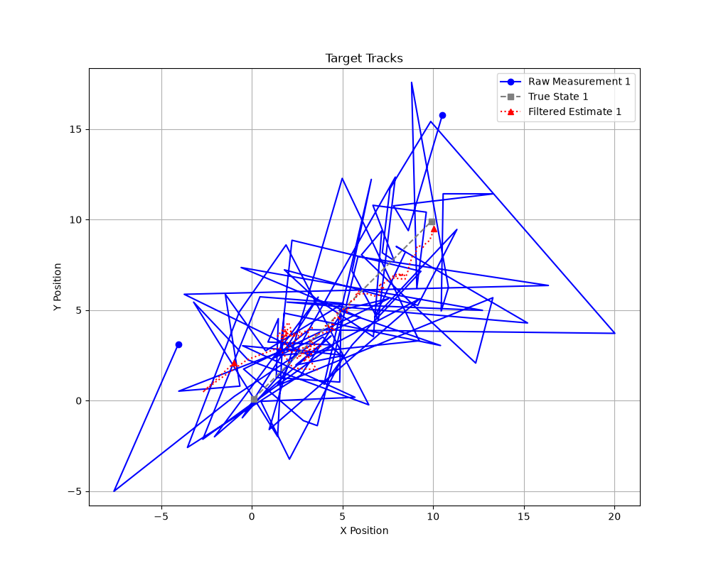

## Stage 2 (Nonlinear measurement model, EKF)

The `ExtendedKalmanFilter` class was created, built as a subclass of `KalmanFilter`. It overrides the covariance update to use Joseph form for numerical stability. In addition, `RadarRangeBearing` was created as a range-bearing measurement model. Using a linear measurement model (`LinearPosition2D`), EKF output matches `KalmanFilter` state and covariance to 1e-10 over 100 steps.

| Check | Result |
|---|---|
| EKF vs. `KalmanFilter` on a linear `h`, state & covariance | Match to 1e-10 over 100 steps |
| Analytic radar Jacobian vs. numerical approximation | Match |
| Jacobian at the sensor origin (`q` floored) | Stays finite |

Run via `pytest tests/test_ekf.py -v`.

## Stage 3 (Angle wrapping)

Before implementing the unscented Kalman filter, the angle wrapping functions were tested. This included ensuring the functions work across boundaries and branch cuts. This was done through `scripts/demo_angle_wrapping.py`, which implemented two EKFs, one with and one without the angle wrapping mechanism. The scenario had a target pass behind the sensor, causing the true bearing to cross the ±π branch cut around t≈5s. The results show that without the mechanism, the filter performs far worse:

| Angle wrapping | RMSE |
|---|---|
| Enabled | 7.17 |
| Disabled | 183.87 |

Run via `python scripts/demo_angle_wrapping.py`.

**Position error vs. time for EKF with and without angle wrapping, showing the unwrapped filter diverging at the ±π crossing**
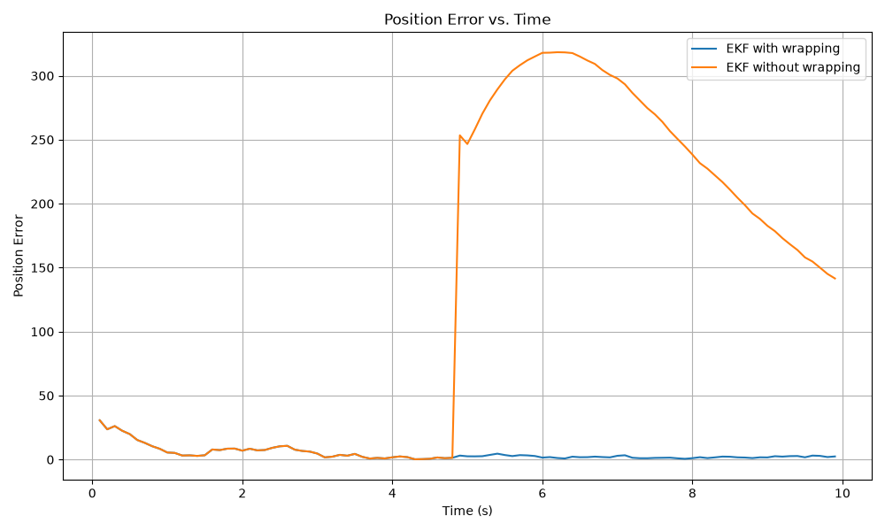

**True bearing vs. time, showing the discontinuous jump from -180° to +180° at the crossing**
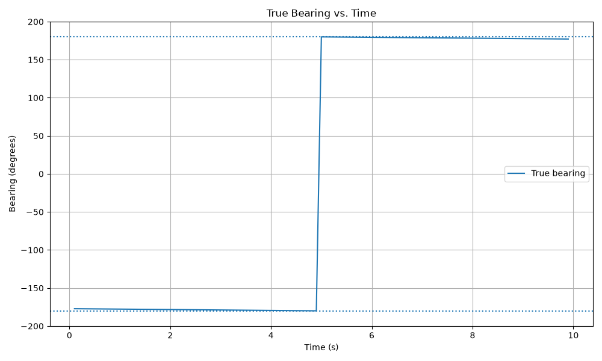

## Stage 4 (The UKF)

The `UnscentedKalmanFilter` class is a subclass of `KalmanFilter`, overriding the innovation and update steps through helper functions. `sigma_points` generates sigma points and weights given a state vector and covariance matrix, along with the UKF's own parameters (`alpha=1e-3`, `beta=2`, `kappa=0`). `_measurement_prediction` implements the unscented transform and is used to avoid duplicating the `h()` computation in both `innovation` and `update`. In addition, the update step also includes a generalized Joseph form, using an effective `H` recovered from the state-measurement cross-covariance and the state covariance matrix.

The script `scripts/demo_ukf_vs_ekf.py` compares UKF to EKF in a scenario that replicates a well-known bearing but poorly-known range. This was done through a `RadarRangeBearing` model with `sigma_range` inflated to make range measurements nearly uninformative (*at this stage the dedicated bearing-only sensor had yet to be created*).

| Filter | NEES | RMSE |
|---|---|---|
| EKF | 3.09 | 3.41 |
| UKF | 2.92 | 3.49 |

Both filters were conservative (NEES below the ideal of 4), with EKF marginally better calibrated than UKF here. The UKF is expected to outperform the EKF in a genuinely bearing-only scenario, since bearing-only measurements are more nonlinear and the UKF handles that nonlinearity better than a first-order Taylor linearization. As this scenario only approximates bearing-only (it's still a 2-D range-bearing sensor with inflated range noise, not a true dim_z=1 sensor), the comparison here is close and non-decisive by design. A more comprehensive test follows once Stage 5's dedicated bearing-only sensor exists.

Run via `python scripts/demo_ukf_vs_ekf.py`.

**NEES vs. time for EKF and UKF, averaged over 30 trials**
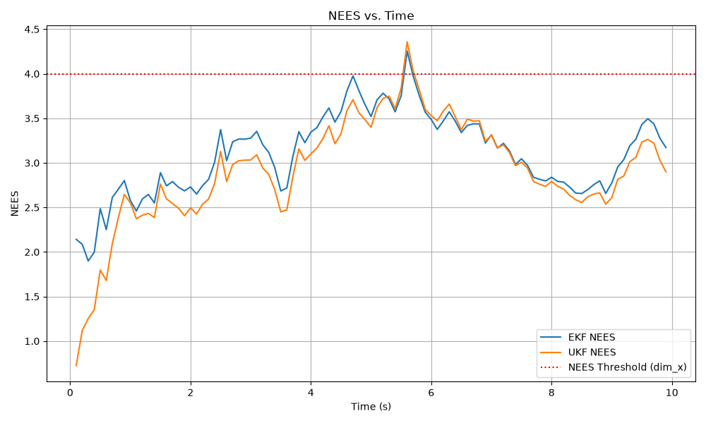

**Position error vs. time for EKF and UKF, averaged over 30 trials**
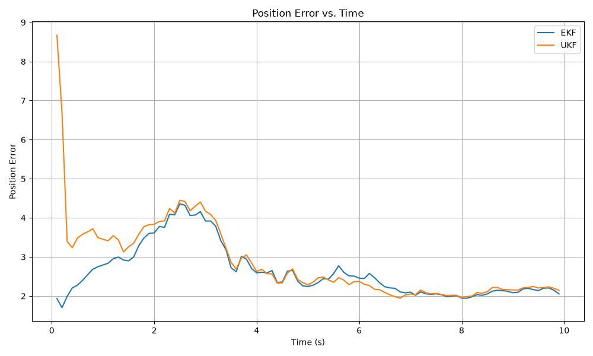

## Stage 5 (Bearing-only model, sequential fusion)

`EOIRBearingOnly`, a one-dimensional bearing-only measurement model, was created. Sequential fusion was implemented through `fuse_sequential`, which reassigns a filter's `measurement` model between `update()` calls (radar then EO/IR). To best visualize the results of EOIR vs. radar vs. fusion across both UKF and EKF, a covariance-ellipse plotting module was created, which shows each filter's confidence under each of its models.

The results were collected via `scripts/demo_sequential_fusion.py`, in which radar and EO/IR were placed at different positions.

| Filter | Sensor | `det(P)` | RMSE |
|---|---|---|---|
| EKF | Radar-only | 0.431 | 2.03 |
| EKF | EOIR-only | 0.078 | 7.21 |
| EKF | Fused | 1.12×10⁻³ | 0.32 |
| UKF | Radar-only | 0.430 | 2.08 |
| UKF | EOIR-only | 0.086 | 7.10 |
| UKF | Fused | 1.14×10⁻³ | 0.32 |

UKF's numbers are nearly identical to EKF's here. Fusion beats both individual sensors on both metrics, visible directly in the fusion ellipse as well. EOIR-only's RMSE is much worse than radar-only's because bearing-only measurements provide no direct range information. The position along the EOIR sensor's own line of sight can only be resolved slowly, through triangulation, as the target's bearing angle changes over time.

Run via `python scripts/demo_sequential_fusion.py`.

**EKF position uncertainty ellipses for radar-only, EOIR-only, and fused**
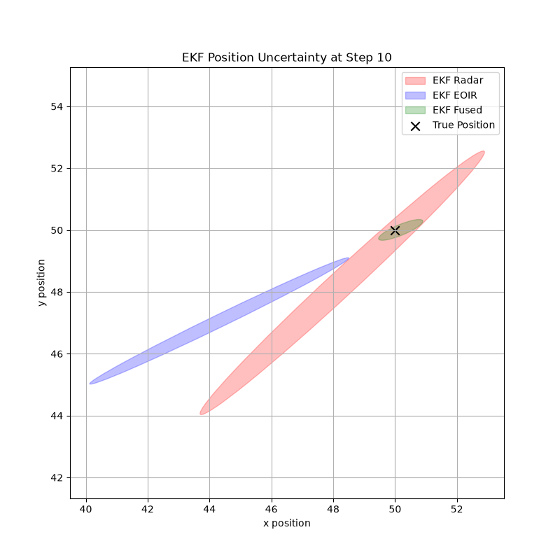

**UKF position uncertainty ellipses for radar-only, EOIR-only, and fused**
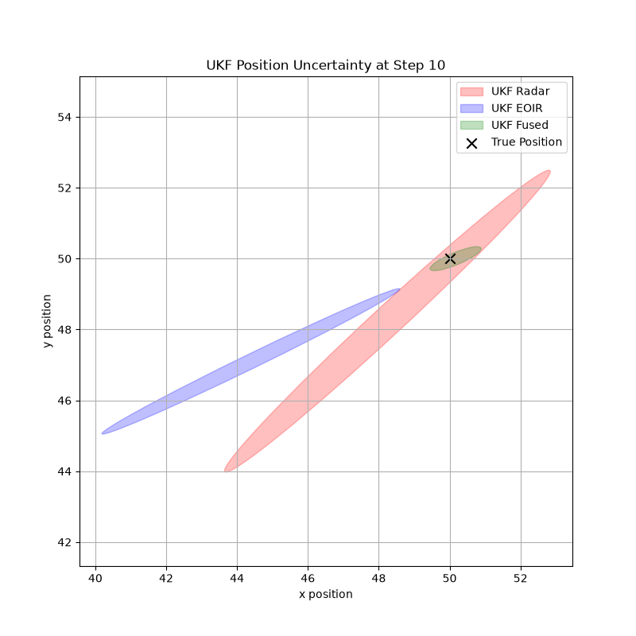

## Stage 6 (Track-level fusion, naive & Covariance Intersection)

Two types of track-level fusion were implemented. `fuse_naive` uses an inverse-covariance-weighted combination of two state estimates, while `covariance_intersection` implements covariance intersection with an `omega` chosen to minimize the determinant of the fused covariance matrix. Rather than *measurement-level* fusion (which updates a single shared filter), these are examples of *track-level* fusion. Radar and EO/IR each run their own independent `ExtendedKalmanFilter`, sharing only a common initial prior. The shared prior is the source of correlation naive fusion can't account for, since it assumes independence, unlike covariance intersection (CI). CI does not assume independence and thus is never overconfident, though it can be more conservative than the naive approach. At each step, the two tracks' current estimates are combined post-hoc, purely for evaluation, with the fused result never fed back into either filter.

The script `scripts/demo_track_fusion.py` compared naive vs. CI fusion for EKF, across 30 Monte Carlo trials.

| Fusion style | Mean NEES |
|---|---|
| Naive | 6.081 |
| CI | 3.551 |

This supports the expectation above. Naive fusion is overconfident (NEES well above the ideal of 4), while CI is conservative. The covariance-determinant ratio `det(P_CI)/det(P_naive)` stayed between ~16x (start of run) and ~11x (end) across the full 10-second trajectory, confirming CI is never more confident than naive fusion at any point.

Run via `python scripts/demo_track_fusion.py`.

**Mean NEES over time for naive fusion vs. Covariance Intersection, averaged over 30 trials**
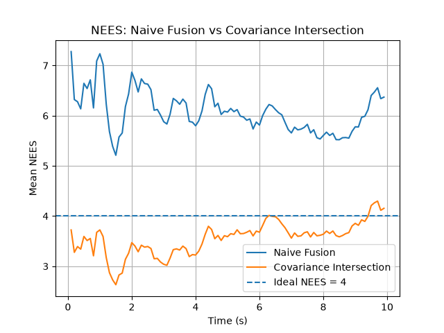

**Ratio of CI's to naive fusion's covariance determinant over time**
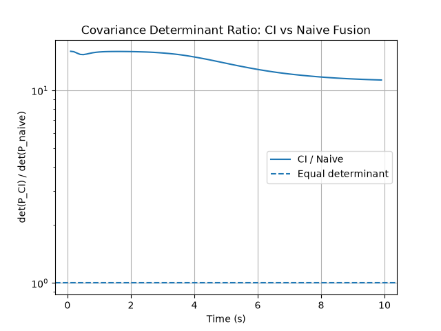

## Stage 7 (Non-Gaussian sensor noise, contaminated-Gaussian degradation)

To simulate contaminated noise, the function `contaminated_gaussian_noise` corrupts Gaussian noise with a Huber-style mixture. For each sample, with probability `epsilon` (default 0.1), draw from `N(0, kappa²·R)` (the outlier branch); otherwise draw from `N(0, R)` (the nominal branch). *While traditional Huber loss is a linear blend, this uses a per-sample Bernoulli choice instead. A linear blend of two independent Gaussian distributions is itself exactly Gaussian, which would defeat the entire point of simulating non-Gaussian noise.*

The script `scripts/demo_contaminated_noise.py` showcases the degradation of both the EKF and UKF under contaminated noise (using the radar sensor), averaged over 30 Monte Carlo trials, clean vs. contaminated:

| Filter | RMSE (clean) | RMSE (contaminated) | NEES (clean) | NEES (contaminated) |
|---|---|---|---|---|
| EKF | 3.78 | 11.78 | 3.41 | 37.27 |
| UKF | 3.93 | 13.47 | 2.91 | 41.82 |

NEES is the more relevant metric for this experiment, since it directly measures the mismatch between the filter's claimed uncertainty (still anchored to the clean-noise `R`) and its actual uncertainty under the contamination, rather than just the raw position error.

Run via `python scripts/demo_contaminated_noise.py`.

**Mean NEES over time for EKF and UKF, clean vs. contaminated noise, averaged over 30 trials**
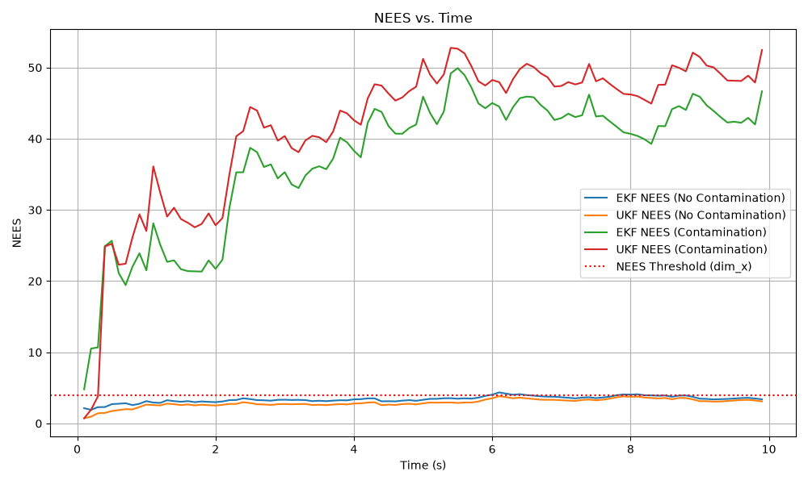

**Mean position error over time for EKF and UKF, clean vs. contaminated noise**
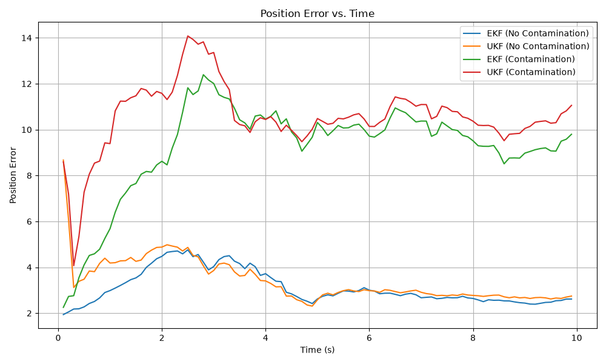

## Stage 8 (Learned measurement denoiser)

To address the contaminated noise introduced in the last stage, `Denoiser` was created. It is a causal dilated 1-D convolutional neural network which smooths raw noisy measurements before they reach a traditional KF/EKF/UKF. It maps 10-step windows of raw contaminated radar measurements to a single Cartesian position estimate. Causality is enforced through left-only padding (verified directly via `test_causality`).

This also required creating `scripts/generate_dataset.py`, which built 10,000 constant-velocity trajectories' worth of windowed training data. Training converged over 40 epochs to a train/val MSE of ~430-460 m², with train and validation loss tracking closely and no overfitting.

The script `scripts/run_comparison.py` ran a four-way comparison, averaged over 30 Monte Carlo trials:

| Condition | RMSE | NEES |
|---|---|---|
| EKF, contaminated | 12.23 | 39.18 |
| Denoiser alone, contaminated | 30.25 | N/A (no covariance output) |
| Denoiser → KF, contaminated | 27.96 | 73.62 |
| EKF, clean | 3.85 | 3.50 |

*These results introduced the biggest obstacle this project had yet seen.* The denoiser made both RMSE and NEES worse, not better. This was because consecutive denoiser windows overlap on 9 of their 10 measurements, so the downstream KF's measurement-independence assumption is violated and it becomes overconfident. This meant that the same handful of raw measurements across many consecutive "independent" updates were being double counted. This motivated the next stage, a learned `R` trained via negative log-likelihood (NLL), and also showed that the real failure mode here is correlation across steps, not per-sample noise. Thus the fix needs a loss computed over many steps, not one sample at a time.

Run via `python scripts/generate_dataset.py`, `python scripts/train_denoiser.py`, and `python scripts/run_comparison.py`.

**Train/validation MSE loss across epochs for the `Denoiser` trunk**
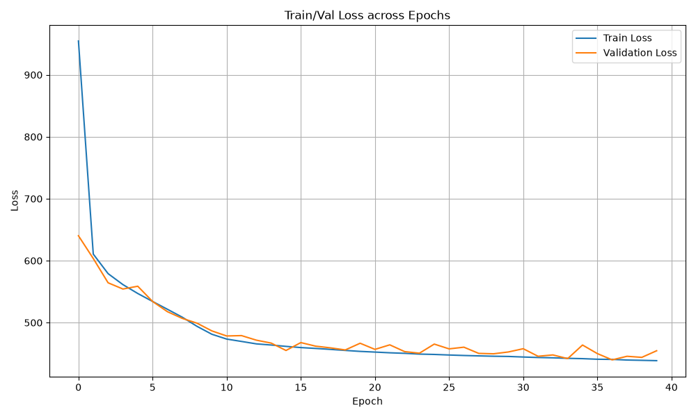

*(These conditions are an exact subset of the seven-condition chart embedded in Stage 10 below.)*

## Stage 9 (Learned adaptive noise covariance)

To create the new `AdaptiveDenoiser`, `CovarianceHead` was first created. This is a small head (one `LayerNorm` layer, then one linear layer) which maps the frozen `Denoiser`'s features to a lower-triangular `L`, with a softplus-scaled, floor-protected diagonal for guaranteed positive-definiteness. It was trained using `gaussian_nll`, which computes mean NLL over each batch (derived from the Gaussian probability density function), so the loss directly penalizes overconfidence rather than just raw position error. The `LayerNorm` layer was a necessary fix found during debugging. Without it, the untrained head's pre-softplus outputs swung between -63 and +55, driven by the trunk's unbounded, unnormalized feature scale, producing NLL losses in the 10^12 to 10^15 range right at initialization. `AdaptiveDenoiser` wraps `Denoiser` with the `CovarianceHead` and outputs a per-window measurement covariance, in place of trusting the sensor's original fixed `R`. `AdaptivePosition2D` was created as a measurement model that gets fed this learned covariance through `set_R()`. Otherwise it is identical to `LinearPosition2D`.

The script `tune_baseline_alpha.py` was used to find the optimal `alpha` inflating `sigma_pos` in the linear model to achieve a NEES of 4, using tuning seeds disjoint from the comparison trials; this gave `alpha = 3.88`. `run_comparison.py` was reworked to add two more conditions (denoiser → KF with this tuned `alpha`; denoiser → KF with the learned, adaptive `R`). As previously noted, the last stage ended with an overconfident KF after the denoiser.

| Condition | RMSE | NEES |
|---|---|---|
| Denoiser → KF, tuned `alpha` | 24.14 | 4.57 |
| Denoiser → KF, learned adaptive `R` | 15.50 | 23.22 |

While per-sample NLL training made real progress on calibration (NEES 73.62 to 23.22), it did not close the gap to the tuned baseline (4.57) or the ideal of 4. This is because correlation between overlapping denoiser windows is a property of the whole *sequence*, invisible to a loss computed one sample at a time. To address computing loss across steps rather than per sample, the next stage implements `DifferentiableKF` for rollout training.

Interestingly, the learned `R` achieved better RMSE (15.50) than the tuned baseline (24.14) despite worse calibration. The tuned scalar inflates uncertainty uniformly everywhere (trading tracking accuracy for calibration across the board), while the learned head partially discriminates per-window, tightening uncertainty where the window looks trustworthy and widening it where it doesn't, which helps accuracy without fully fixing calibration.

Run via `pytest tests/test_learned_covariance.py tests/test_adaptive_position.py -v`, `python scripts/train_adaptive_r.py`, `python scripts/tune_baseline_alpha.py`, and `python scripts/run_comparison.py`.

**Train/validation NLL loss across epochs for `CovarianceHead`**
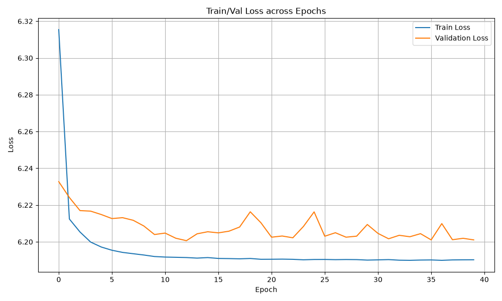

*(These conditions are an exact subset of the seven-condition chart embedded in Stage 10 below.)*

## Stage 10 (`DifferentiableKF` + rollout-retrained covariance)

As previously stated, in order to compute loss per step rather than per sample the learned covariance needed to be trained through rollout methods. `DifferentiableKF` was created in PyTorch for this. It is a batched Kalman filter recursion allowing gradients to flow through several chained predict/update steps. `RolloutCovarianceModel` wraps `DifferentiableKF` with `AdaptiveDenoiser`, so NLL loss is computed on the filtered output rather than the denoiser's raw per-window estimate, giving the gradient access to how consecutive `R` outputs interact with each other across steps. `RolloutWindowDataset` was used to train `RolloutCovarianceModel` and it serves `K` consecutive denoiser windows and targets per sample, instead of independent per-sample pairs, which is what preserves the temporal structure a per-sample dataset would otherwise discard.

The first training attempt failed, with NLL loss converging to around 130 (roughly 18x higher than expected). This was due to an oversight in how every training rollout was initialized. All of them used a single fixed `x0_filter`/`P0` (initial filter state and covariance), which is only a valid prior for a window starting at the trajectory's true `t=0`. In reality, rollout windows are drawn from arbitrary points throughout the 100-step trajectory, where the target has moved far from that initial seed. With `P0`'s position standard deviation around ~3.3m and the actual targets landing 80m-360m away from the seeded starting position, the mismatch was a 25-50 standard-deviation error. This was large enough that the filter needed the entire 20-step window just to converge from the bad prior, dominating the loss with an initialization artifact rather than genuine measurement-noise calibration.

To remedy this, training was redesigned around truncated backpropagation through time (TBPTT), so the loss sees the same temporal correlation the filter faces at deployment. This required running the filter continuously per trajectory, with no gradients, to build a refreshed cache of realistic warm-start states once per epoch, through `compute_warm_states()`. Each trajectory's warm-start state is seeded from the frozen denoiser's own first-window output, rather than the single global constant that caused the original failure. Training then only backpropagates through a short `K`-step slice starting from that already-converged, cached state — matching how the model is actually evaluated (continuous tracking from the true `t=0`).

The retrained run converged to an NLL loss of ~6.1-6.2, almost exactly matching the theoretical well-calibrated estimate. For a 2-D Gaussian measurement update, a perfectly calibrated filter's per-step NLL floor is `dim_z/2 · log(2π) + 1 + 0.5 · log|det(S)|` (the `+1` is one unit of average squared-Mahalanobis distance per dimension, which calibration requires), and evaluated at this scenario's measurement-noise scale, that floor lands right around 6-7.

After this, `run_comparison.py` was amended to add a seventh condition ("Denoiser → KF & Rollout R"):

| Condition | RMSE | NEES |
|---|---|---|
| Denoiser → KF, rollout-trained `R` | 6.42 | 2.33 |

The rollout-trained model decisively beat every other learned condition, with massive improvements on both RMSE and NEES. NEES landed in conservative territory (below the ideal of 4), meaning the filter is now underconfident rather than overconfident (i.e., safer). While the tuned-`alpha` baseline has a NEES numerically closer to the ideal, that's expected rather than a point in its favor: `alpha` was tuned specifically to hit NEES=4 on its own tuning seeds, so landing close to 4 is confirming the tuning worked, not a separate achievement to compare against the rollout model's.

Run via `python scripts/train_rollout_covariance.py`, and `python scripts/run_comparison.py`.

**Train/validation NLL loss across epochs for the rollout-trained covariance head**
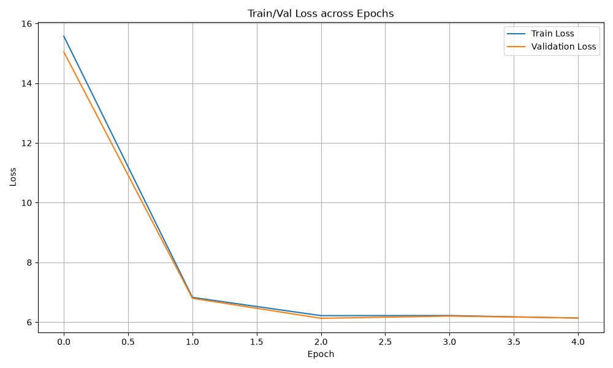

**RMSE across all seven comparison conditions**
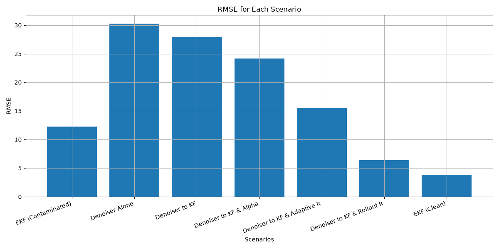

**NEES across the six conditions with a covariance**
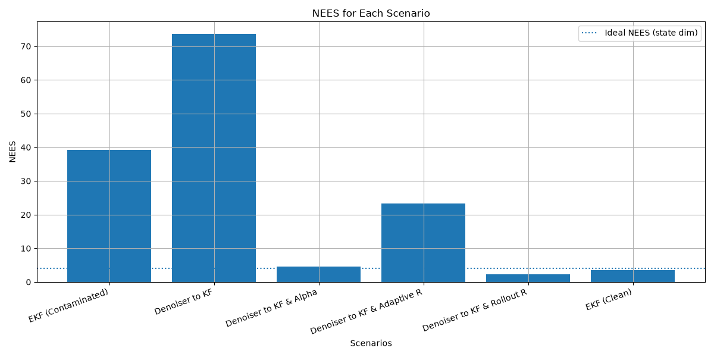

## Stage 11 (Learned clutter classifier)

While the last three stages revolved around the denoiser and covariance, this stage tackles a separate question. To address clutter interfering with the filter, a clutter classifier was created. This was done through scikit-learn's `HistGradientBoostingClassifier`, which uses histogram-binned gradient-boosted decision trees. It solves the data-association problem of whether a given detection is real or clutter, which in turn decides whether a track should be born from it. Rather than sitting inside the filter's own predict/update path, this classifier is incorporated into the tracker's assignment/birth logic instead.

`RadarSensor` wraps `RadarRangeBearing` to produce per-frame detections with Poisson false alarms and free ground-truth labels (for evaluation only, never seen by the classifier). `compute_features` turns each detection into a feature vector with the following features: squared Mahalanobis distance to the nearest track, count of tracks it gates against, and local detection density (Signal-to-Noise Ratio was planned but ultimately skipped to reduce scope). `build_clutter_dataset` assembles these per-detection features plus labels into the labeled training set. Once trained, the classifier is consumed by two functions at inference time: `build_cost_matrix_with_classifier`, which folds its output probability into the tracker's assignment cost matrix (the formula below), and `init_track_from_detection`, the nonlinear-sensor-correct track initializer that inverts range/bearing to seed a new `ExtendedKalmanFilter`/`UnscentedKalmanFilter` when a detection clears the classifier's birth gate. `check_calibration` evaluates how trustworthy the classifier's probabilities actually are, binning predictions by quantile (one bin roughly every 50 samples by default) and reporting, per bin: its boundaries, sample count, mean predicted probability (`prob_pred`), and empirical positive rate (`prob_true`) as well as an overall Brier score. ROC AUC is computed separately, in the scripts that call `check_calibration` rather than inside it.

While Project 1's own `MultiTargetTracker` exists, it has no injection point for a different cost function and assumes linear Cartesian coordinates. As a result, a new, standalone `MultiTargetTrackerClutter` class was created with the same architecture (hit/miss/confirm/death lifecycle, Hungarian assignment, chi-square gating), but with an optional classifier parameter for the cost-matrix calculation and native range/bearing coordinates throughout.

The first classifier training yielded an AUC of 0.9970 and a Brier score of 0.0204, but its predictions were clustered at the extremes, with only 12 of 20 calibration bins populated. A sparsely-populated bin means too few validation samples fell into that probability range to compute a reliable empirical rate at all. Here, that happened because the classifier was so confident in both directions that almost nothing landed in the uncertain middle, a warning sign that got confirmed by what happened next. The first comparison, under `scripts/run_clutter_comparison.py`, was between the baseline tracker (no classifier) and the classifier-augmented one, folding the classifier into the assignment cost itself as follows:

```
cost_ij = d_ij² − 2·log(Pr(target_j))
```

Rows (`i`) are tracks, columns (`j`) are detections. The classifier enters as an additive term that depends only on the detection, not the track. This comparison produced bit-for-bit identical results across every trial. This was not a bug, but a structural property of the formula that I overlooked. Since the `−2·log(Pr(target_j))` term is constant across every row (`i`) for a fixed column (`j`), it shifts an entire column of the cost matrix by the same amount and therefore can never change which assignment is optimal for a standard linear-assignment solver (confirmed directly against `scipy.optimize.linear_sum_assignment`). The term is subtracted, rather than added, specifically because it needs to make an already-good match (high `Pr(target_j)`) *cheaper*, matching the convention that a lower cost means a better assignment (although this was in vain due to the error mentioned above). This motivated the pivot to using the classifier not inside the cost matrix, but instead to gate detections at track **birth**, by comparing the probability the detection is a target against a `birth_threshold` and rejecting the detection if it falls below it. This would correctly change the optimal assignment.

The second attempt, with `birth_threshold=0.5`, caused zero tracks to ever be confirmed. The root cause was that `build_clutter_dataset` had pre-seeded tracks from ground truth, so a real target in the training data never once faced an empty track list. Instead it always had at least one track nearby to compute a finite Mahalanobis distance against. Live trackers, by contrast, bootstrap from nothing, so every real target's very first detection has no track yet and triggers `compute_features`'s `min_distance=inf` sentinel (its stand-in for "no track yet"). Because the classifier had only ever seen that sentinel attached to clutter during training, it gave a genuine cold-start real detection a predicted `Pr(target)` of just 0.0003 (effectively certain it was clutter), when it was a real target that simply hadn't had time to accumulate a track yet. This was fixed by removing the ground-truth pre-seeding in favor of on-demand birth via the same `init_track_from_detection` the live tracker uses, then regenerating the dataset and retraining.

| Training attempt | AUC | Brier score | Calibration bins populated |
|---|---|---|---|
| 1st (ground-truth pre-seeded) | 0.9970 | 0.0204 | 12/20 |
| 2nd (on-demand birth, same as deployment) | 0.9928 | 0.0312 | 20/20 |

The slightly worse AUC/Brier score here is the honest cost of training on a harder, more representative distribution — not a regression — and every bin now has enough samples to report a meaningful rate.

Running the comparison a second time gave a real but mixed result at `birth_threshold=0.5`. ID switches improved (baseline 1.667 vs classifier 1.367) while false-track rate got worse (baseline 0.1746 vs classifier 0.2080). Since `0.5` had been an arbitrary starting guess, `scripts/sweep_birth_threshold.py` swept `[0.1, 0.3, 0.5, 0.7, 0.9]` to check whether that trade-off was threshold-specific or fundamental. `0.5` turned out to be an unlucky pick, with `0.1`, `0.3`, and `0.7` all beating the baseline on both metrics simultaneously. `0.3` strictly dominated every value tested, and `0.9` reproduced the same zero-confirmed-tracks failure.

**Final result, `birth_threshold=0.3`:**

| Metric | Baseline | Classifier | Change |
|---|---|---|---|
| ID switches | 1.667 | 1.200 | ↓28% |
| False-track rate | 0.1746 | 0.1605 | ↓8% |

Run via `python scripts/train_clutter_classifier.py`, `python scripts/sweep_birth_threshold.py`, and `python scripts/run_clutter_comparison.py`.

**Reliability diagram for the retrained clutter classifier**
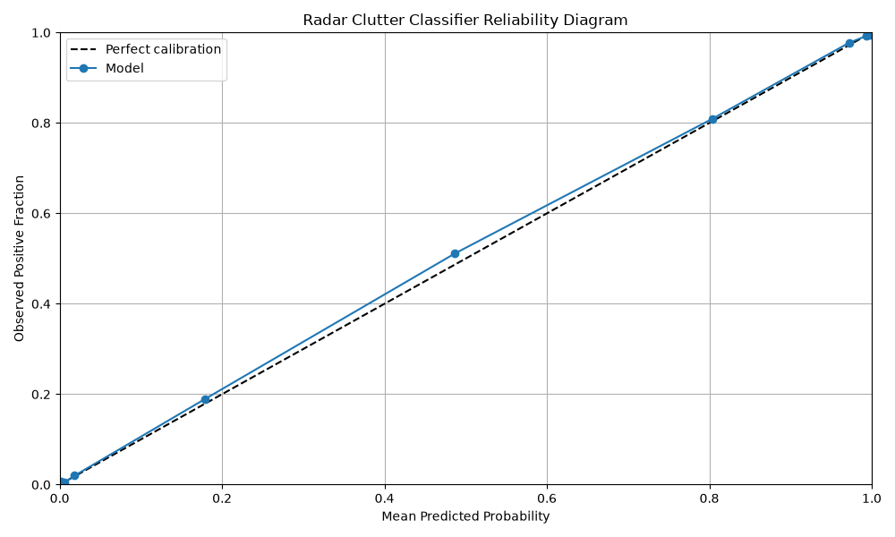

**ID switches vs. birth_threshold, with a dashed baseline reference line**
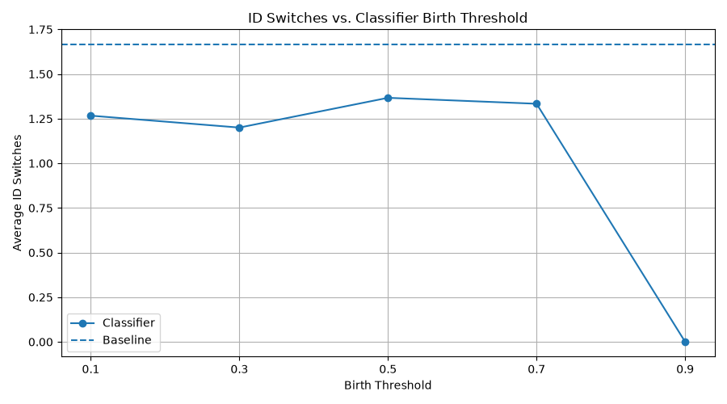

**Average false-track rate vs. birth_threshold, with a dashed baseline reference line**
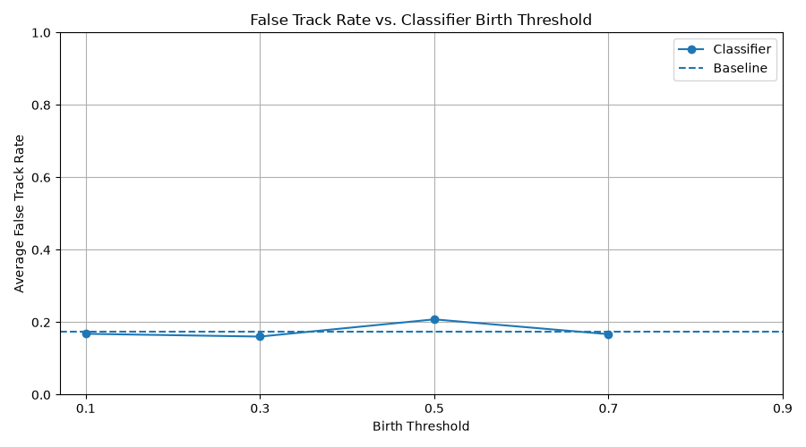

**Baseline vs. classifier-augmented tracker at the chosen birth_threshold=0.3**
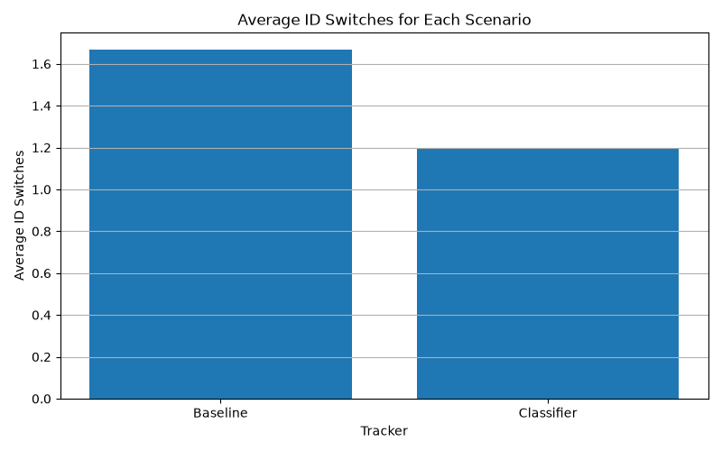

**Baseline vs. classifier-augmented tracker at the chosen birth_threshold=0.3**
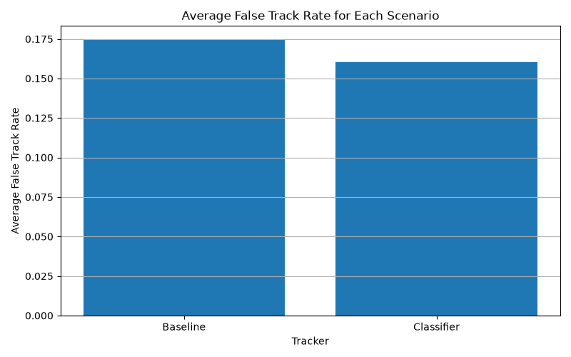

## Stage 12 (Learned dynamics via `ResidualDynamicsKF`, vs. CV baseline vs. IMM)

This stage sought to use a learned method, `ResidualDynamicsKF`, against maneuvering targets, which violate a Kalman filter's constant-velocity motion assumption. Alongside it, an Interacting Multiple Model (IMM), a typical classical solution to the maneuvering problem, was also implemented, to compare the learned method against both a naive baseline and a dedicated classical one.

`ResidualDynamicsNet` is a residual-correction neural network that predicts a small correction to the constant-velocity prediction (`delta`), plus a learned, Cholesky-parameterized process-noise covariance (lower-triangular `L` for `Q = LLᵀ`), given the current state and an optional recurrent hidden state `h`. That hidden state is a GRU cell's running summary of the track's recent kinematic history. It lets the correction understand whether the track is at the start, middle or end of a turn, as a lone position/velocity snapshot can't distinguish this. It is trained via TBPTT through `DifferentiableKF`. `ResidualDynamicsKF` composes `DifferentiableKF` with `ResidualDynamicsNet` via a new `dynamics_fn` hook that replaces the fixed `F`/`Q` predict step with the network's own correction and covariance each step.

The training data, `ManeuverRolloutDataset`, uses `waypoint_trajectory`, which concatenates the existing `coordinated_turn_trajectory` and `constant_velocity_trajectory` into randomized multi-leg paths (random leg duration, turn probability, and turn rate). Training also incorporates the same cache strategy as Stage 10, through `compute_maneuver_warm_states()`. This caches realistic per-trajectory warm starts once per epoch, seeded from the model's own first noisy measurement (zero velocity, since the first state hasn't yet provided any velocity information) rather than ground truth. Loss is MSE over the full position/velocity state, not NLL as accuracy is the goal, not calibration.

Another motion model was created, `CoordinatedTurn2D`, which uses a fixed turn rate. The IMM, `InteractingMultipleModel`, uses three modes, CV, CT+, and CT−, for straight legs, counterclockwise turns, and clockwise turns respectively. It uses three steps. First, mixing (blending each mode's prior estimate using the previous step's mode probabilities and the Markov `transition_matrix`) is done via `gaussian_mixture_moments`. Then each mode's own predict/update is then just that mode's own `KalmanFilter`-style step, run independently per mode. The mode-probability update (how likely each mode is, given how well it just predicted the new measurement) is done via `gaussian_likelihood`, which scores each mode's innovation against its own `S`.

To help with evaluation, `classify_maneuver_segments` classifies each step of a trajectory as straight or turning from its own heading rate (thresholded at `omega_threshold`). This allows scoring not just overall performance, but performance specifically on straight legs vs. turning legs.

The script `tune_maneuver_baseline.py` was used to tune `sigma_a` for the CV baseline and for each mode of the IMM. In addition, the IMM's fixed turn rate `omega` was set as the median absolute heading-rate pooled across every turning step in the tuning set. This was chosen because the dataset's turn directions are random and roughly balanced.

The final comparison, `run_maneuver_comparison.py`, calculated the RMSE and NEES for the three methods (CV baseline, IMM, and `ResidualDynamicsKF`) for straight legs, turning legs, and overall:

| Method | RMSE (straight / turning / overall) | NEES (straight / turning / overall) |
|---|---|---|
| CV baseline | 4.11 / 4.22 / 4.15 | 2.94 / 5.30 / **3.88** |
| IMM | 4.15 / 4.22 / 4.18 | 2.29 / **3.04** / 2.59 |
| `ResidualDynamicsKF` | **3.91** / **3.98** / **3.94** | **3.89** / 7.80 / 5.45 |

The trained model has the best RMSE in every regime, but at the cost of calibration. This was expected, since its loss (MSE) never rewarded honest uncertainty. It lands specifically on turning (NEES 7.80) rather than straight legs (NEES 3.89). (i.e. it's most overconfident exactly where the dynamics are hardest to predict). IMM is better calibrated during turns, though its accuracy doesn't improve over the CV baseline. The IMM's fixed `omega` for the CT modes is an inaccurate stand-in for the dataset's actual turn-rate spread, and the Markov transition matrix's self-persistence means its mode probability lags briefly after a real turn begins. Both of which erode the tracking-accuracy edge a correctly-identified CT model would otherwise provide. Although the CV baseline has the best NEES *overall*, it is miscalibrated within each individual leg type (conservative on straight, overconfident on turning). It was tuned on a blend of both regimes rather than one or the other, whereas each IMM mode was tuned on its own respective regime alone.

Run via `python scripts/generate_maneuver_dataset.py`, `python scripts/train_residual_dynamics.py`, `python scripts/tune_maneuver_baseline.py`, and `python scripts/run_maneuver_comparison.py`.

**Train/validation MSE loss across epochs for ResidualDynamicsKF**
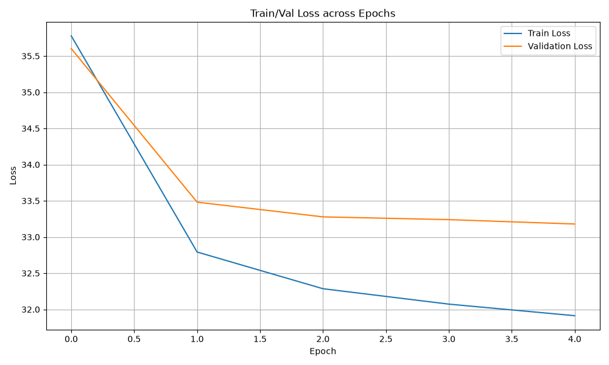

**RMSE by regime (straight/turning/overall) for CV baseline, IMM, and ResidualDynamicsKF**
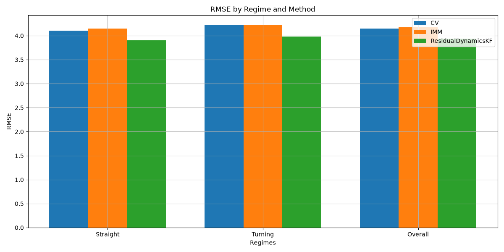

**Mean NEES by regime for the same three methods**
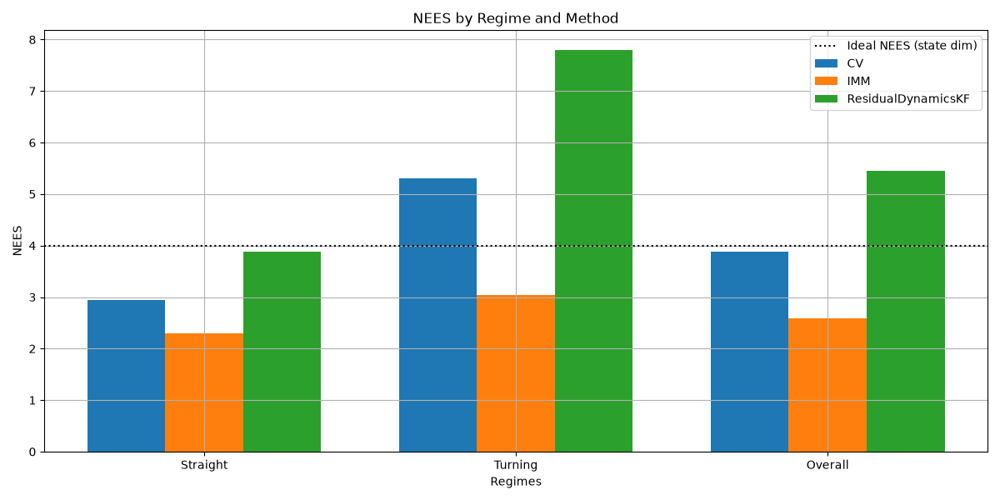

## Stage 13 (Final comparison matrix: methods × scenarios, RMSE + NEES)

For the final comparison, done through `run_final_comparison.py`, every classical filter (EKF, UKF, IMM) as well as all learned components were compared. In addition, `FullPipelineModel` was created, combining the denoiser trunk, learned covariance head, and learned dynamics correction into one jointly-trained model. Each row was scored on the same metrics (RMSE/NEES, or ID switches/false-track rate for clutter) across six scenario columns: benign, maneuvering, contaminated sensor noise, heavy clutter, bearing-only, and dual-sensor fusion. The last column compares the sequential, naive, and Covariance Intersection fusion styles for both EKF and UKF.

Each classical method's `sigma_a` was freshly retuned, per scenario, in its own tuning script against the ideal NEES of 4. To implement the comparison itself, helper functions for building and running filters and scenarios live in `comparison_common_fn.py`, `scenarios.py`, and `filters.py`. To run the learned components on bearing-only scenarios, bearing-only training data was generated from scratch and a bearing-only denoiser and rollout covariance head were trained. Two full-pipeline models (one for range/bearing, one for bearing-only) were created and trained end-to-end.

Finally, to better understand how outliers affect NEES, per-seed NEES and minimum range to the sensor were collected for every scenario in `report_scenario_outliers.py` (*see "Scenario outlier diagnostics" below*). Separately, `recheck_clutter_calibration_ukf.py` confirmed that the clutter classifier did not need to be retrained for UKF (*see the figure and numbers under discrepancy note 4 below*).

Two roadblocks surfaced while building this stage. First, `UnscentedKalmanFilter`'s update step needed a generalized Joseph form to stop `P` from becoming non-positive-definite. Second, `build_cost_matrix_with_classifier` crashed with frames that had zero total detections (when a zero-clutter draw coincided with every visible target being missed in the same frame). This was fixed with an early return, since the already-correctly-shaped empty cost matrix is the right answer in that case.

This stage deliberately did not retrain any of the learned components to force them onto a shared evaluation convention. Several of them were trained under a different sensor noise scale, measurement model, or trajectory distribution than the column they're compared alongside. Each such row is evaluated at its own checkpoint's native setting, and the mismatch is documented explicitly below (*see "Known discrepancies"*).

**The matrix** (RMSE / mean NEES per cell, ideal NEES = 4; `—` = not applicable to that method/scenario combination; `Heavy Clutter` scored on mean ID switches / false-track rate instead):

| Method | Benign | Maneuvering (overall) | Contaminated | Heavy Clutter | Bearing-Only | Dual-Sensor Fusion |
|---|---|---|---|---|---|---|
| EKF | 10.47 / 38.34 ¹ ¹⁰ | 28.04 / 123.65 ¹ | 22.06 / 246.62 ² | 1.667 / 0.165 ⁹ | 8475.85 / 208.49 ² | — |
| UKF | 13.36 / 13.42 ¹ | 9.01 / 4.14 ¹ | — ³ | 1.667 / 0.165 ⁴ ⁹ | 307.47 / 832.0 ² | — |
| IMM | — | 15.92 / 81.14 ¹ ¹⁰ | — | — | — | — |
| + denoiser | — | — | 28.10 / 24.77 ⁵ | — | 56.02 / 8.00 ⁵ | — |
| + denoiser/learned R | — | — | 30.10 / 7.31 ⁵ | — | 57.58 / 0.68 ⁵ | — |
| + learned dynamics | — | 3.94 / 5.44 ⁶ | — | — | 3.94 / 5.44 ⁶ | — |
| Full pipeline | — | 31.89 / 4.18 ⁷ | 46.65 / 3.91 ⁷ | — | 67.57 / 5.28 ⁷ | — |
| Sequential fusion (EKF) | — | — | — | — | — | 5.93 / 3.33 |
| Sequential fusion (UKF) | — | — | — | — | — | 18.08 / 53.24 ⁸ |
| Naive fusion (EKF) | — | — | — | — | — | 6.19 / 159.11 ⁸ |
| Naive fusion (UKF) | — | — | — | — | — | 32.24 / 158.20 ⁸ |
| CI fusion (EKF) | — | — | — | — | — | 7.24 / 117.63 ⁸ |
| CI fusion (UKF) | — | — | — | — | — | 32.53 / 90.49 ⁸ |

Maneuvering also splits straight/turning (RMSE / NEES, ideal 4): EKF **35.26 / 70.98** (straight) vs. **11.49 / 198.99** (turning); UKF **9.13 / 3.39** vs. **8.84 / 5.23**; IMM **18.25 / 51.78** vs. **11.80 / 123.13**.

**Known discrepancies:**

- **¹ Benign/maneuvering's EKF and IMM NEES are dominated by a handful of unlucky spawns, not systemic miscalibration.** When a target's true initial range happens to be small relative to the sensor's `sigma_range` (20m), a single noisy range/bearing measurement at spawn carries almost no real signal, producing a catastrophically wrong initial fix the filter only slowly recovers from. Excluding the 2-3 affected seeds (out of 30): benign EKF's NEES drops **38.34 → 2.38**, benign UKF **13.42 → 2.77**, maneuvering EKF (overall) **123.65 → 4.02**, maneuvering IMM (overall) **81.14 → 2.72**. UKF is measurably more robust to this failure mode than EKF.
- **² Contaminated and bearing-only's poor EKF/UKF calibration is real, and is *not* the same spawn-proximity effect as (1).** The same outlier diagnostic shows catastrophic seeds spread across the *entire* min-range axis for both columns, not clustered near the sensor. This is the contaminated-Gaussian-noise mechanism working exactly as designed, compounded severely by bearing-only's geometry. Bearing-only's EKF is **100% catastrophic across all 30 seeds** (median per-seed NEES 166.2, every individual RMSE in the thousands), much worse than contaminated's own 70%-catastrophic rate.
- **³ UKF has no `contaminated` cell, by design, not by omission.** `scripts/tune_contaminated.py` found no bracket where UKF's NEES crosses 4 under this column's noise. The tuning script's own diagnostics are the documented reason (see that file). There is no tuned baseline to evaluate against.
- **⁴ Heavy Clutter's EKF and UKF rows are bit-for-bit identical, confirmed as a real tie, not a bug.** This was checked directly on a shared seed/measurement stream. The two filters' continuous state estimates differ in the 4th decimal place, but every discrete tracking decision (gating, assignment, birth, confirmation) comes out identical, because `sigma_range=100` is small relative to this scenario's `range_max=10000` geometry. The numeric gap between EKF and UKF never flips a single discrete decision at this scale. Separately, the clutter classifier (trained on EKF-generated Mahalanobis-distance features) was rechecked against UKF-generated features before trusting this cell. The resulting ROC AUC of 0.9936 and Brier score of 0.0293 essentially match the EKF-trained validation numbers (0.9928 / 0.0312), confirming the classifier generalizes across both filters and needed no retraining.

**UKF-generated-feature reliability diagram for the clutter classifier**
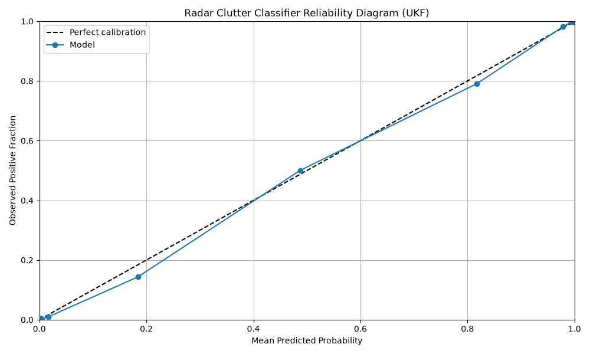

- **⁵ Denoiser and learned R rows (for `contaminated`, `bearing_only` columns) are evaluated at each checkpoint's own native noise scale, not the column's own tuned stream.** Both were trained at `sigma_range=100`, not `contaminated`'s own tuned `sigma_range=20` (the value EKF/UKF's row above uses). This means the raw RMSE ordering in `contaminated`, with EKF (22.06) beating every learned row (28.10-46.65), is **not** a fair head-to-head: EKF is solving an easier (lower-noise) problem than the learned rows are. The right comparison is each learned row against its *own* honest classical floor, not across the column.
- **⁶ Learned dynamics row is identical in both `maneuvering` and `bearing_only`.** `ResidualDynamicsKF` was trained on direct Cartesian position measurements (`LinearPosition2D`, `sigma_pos=5`), never on `RadarRangeBearing` or any bearing-only sensor at all. `DifferentiableKF` (the torch KF it's built on) has no nonlinear measurement-update path, so it architecturally cannot consume the same range-bearing stream every other row in these two columns uses. It also draws from a different, fixed held-out trajectory split (Stage 12's own validation set) rather than the `mc_seeds`-driven fresh-per-seed convention every other row follows.
- **⁷ Full pipeline's two populated range-bearing cells have asymmetric epistemic status, and all three cells use each checkpoint's own native contaminated-noise stream, not the column's tuned one.** The `maneuvering` cell (turning trajectory, matching training) is fully in-distribution for the model, while the `contaminated` cell (forced straight-CV trajectory) is a genuine out-of-distribution generalization test, since the model was trained only on turning trajectories. This asymmetry is the documented reason `contaminated`'s full-pipeline RMSE (46.65) is worse than `maneuvering`'s (31.89), not a reporting inconsistency. Calibration is full pipeline's clear strength everywhere. All three cells land close to the ideal NEES=4, markedly better than the individual learned components on calibration. This comes at a cost to RMSE, which is the worst of the three learned options in both `contaminated` and `bearing_only`.
- **⁸ Dual-sensor fusion's naive/CI NEES numbers are inflated by the same spawn pathology as (1), confirmed via the same diagnostic extended to this column.** `ci_EKF`'s pooled NEES (117.63) collapses to **2.34** excluding 2 catastrophic seeds (the identical pair already flagged for `benign`). `naive_EKF`'s 159.11 collapses to **2.87** excluding 3 catastrophic seeds. Covariance Intersection's core property from Stage 6 ("returns to ≈consistent") holds, but needs the same excluding-outliers treatment. One new finding was found with regard to sequential fusion. It is more robust to this failure mode than track-level fusion. `sequential_EKF` has zero catastrophic seeds at all (pooled NEES 3.33, no exclusion needed). `sequential_UKF` has 2, vs. naive/CI's 2-3 each. This is due to sequential fusion correcting one filter's state immediately via the second sensor's update within the same step, while naive/CI let two independently-run tracks drift on their own geometry before merging post-hoc. Thus there is more room for one track's ill-conditioned update to compound before fusion ever sees it.
- **⁹ Heavy Clutter's EKF/UKF rows already have the classifier baked in (there's no separate baseline row in this table).** Unlike every other column, where "EKF"/"UKF" means the plain classical filter, both rows here run `MultiTargetTrackerClutter` with the tuned classifier gate (`birth_threshold=0.3`) applied unconditionally. There's no non-learned row in this matrix to contrast against, so the cell can't be read as "clutter classifier beats baseline" on its own. That comparison lives in Stage 11's own dedicated before/after (*see results there*).
- **¹⁰ Maneuvering's EKF/IMM rows are not directly comparable to Stage 12's own CV-baseline/IMM table, despite the similar labels.** Stage 12's `run_maneuver_comparison.py` builds the CV baseline and every IMM mode on `LinearPosition2D` (direct Cartesian position, `sigma_pos` noise); Stage 13's `filters.py` builds every maneuvering-column filter (EKF, UKF, and every IMM mode) on RadarRangeBearing instead. That sensor swap, combined with the same close-spawn catastrophic-seed pathology from footnote ¹, fully explains the ~4-7x gap between Stage 12's IMM (4.18 RMSE / 2.59 NEES) and Stage 13's IMM (15.92 RMSE / 81.14 NEES). The one row that is a direct carryover is learned dynamics (see footnote ⁶) which is why it's the only maneuvering row whose numbers match Stage 12's table exactly.

Run via `python scripts/run_final_comparison.py` (produces `data/processed/final_comparison_table.json`) and `python scripts/report_scenario_outliers.py`.

**Train/validation loss across epochs for the range-bearing `FullPipelineModel`**
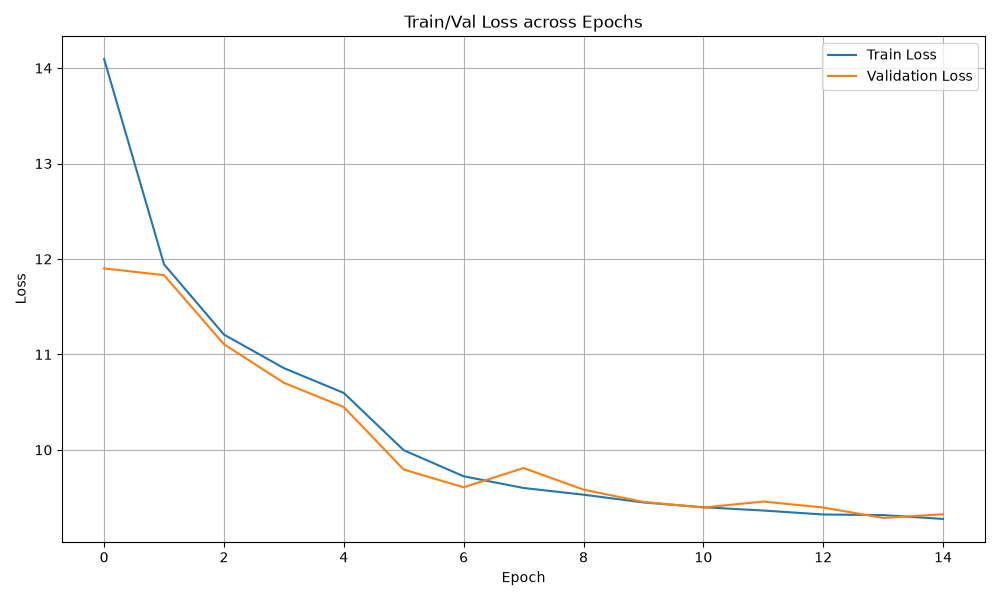

**Train/validation loss across epochs for the bearing-only `FullPipelineModel`**
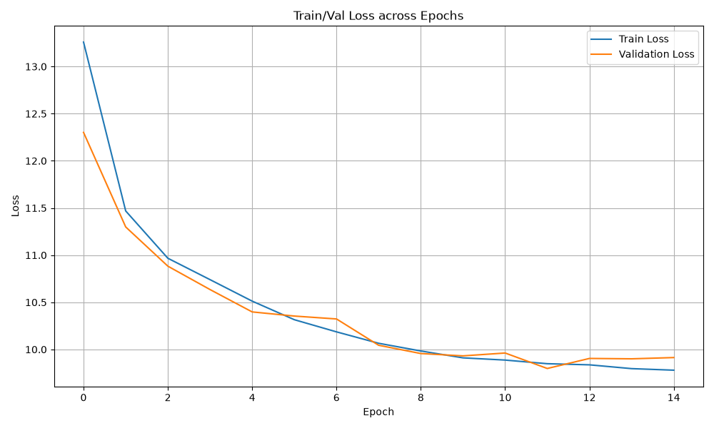

**Train/validation loss across epochs for the bearing-only denoiser**
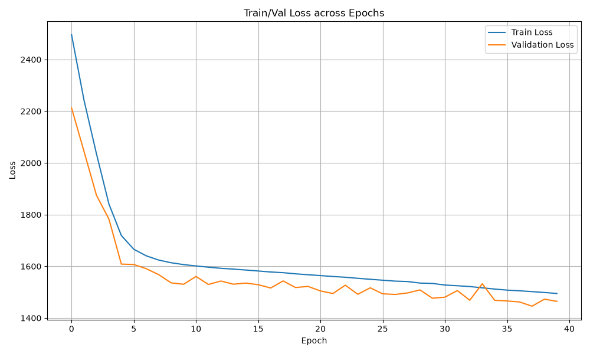

**Train/validation NLL loss across epochs for the bearing-only rollout-trained covariance head**
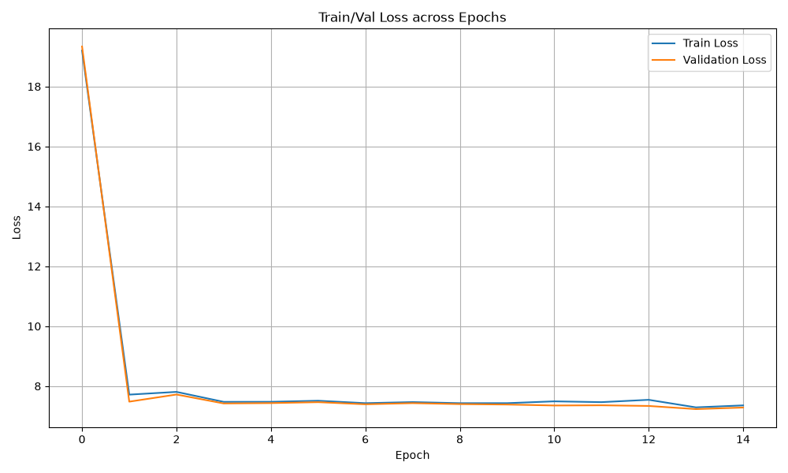

## Scenario outlier diagnostics

Stage 13's EKF/UKF NEES numbers were pooled across all 30 comparison seeds. However, a pooled mean can hide a failure that's severe on a handful of seeds and invisible on the rest. `scripts/report_scenario_outliers.py` (`compute_per_seed_diagnostics`, `summarize_outliers`, `plot_nees_vs_range`) checks each seed individually. Per-seed mean NEES and that seed's minimum range to sensor are checked, flagging anything above a fixed NEES threshold as "catastrophic" rather than averaging it away. Extended later to `dual_sensor_fusion` (`compute_per_seed_diagnostics_dual_sensor`), which needed its own version to handle two sensors, two measurement streams, and (for naive/CI) two independently-run filters merged post-hoc rather than one filter's own covariance.

Two distinct shapes show up in these scatter plots, and the difference between them is the whole point of running this diagnostic rather than trusting the pooled number alone:

**Benign/maneuvering/dual-sensor-fusion: a clean, mechanistic pattern.** Every catastrophic point falls strictly inside `min_range < sigma_range` and every nominal point falls strictly outside it. A target spawning close to the sensor gets a near-meaningless first range/bearing fix (the noise is comparable to the signal), and the filter only slowly recovers. Excluding the 2-3 affected seeds brings every one of these rows down to NEES ≈ 2-3 (mildly conservative, essentially ideal).

**Benign EKF: per-seed NEES vs. minimum range to sensor**
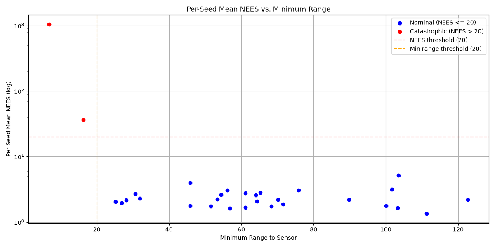

**Benign UKF: per-seed NEES vs. minimum range to sensor**
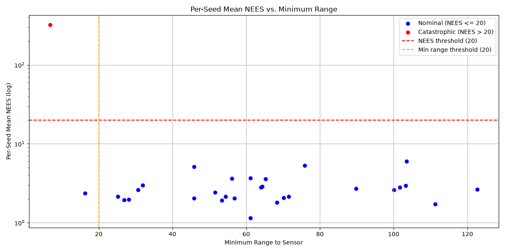

**Maneuvering EKF (overall): per-seed NEES vs. minimum range to sensor**
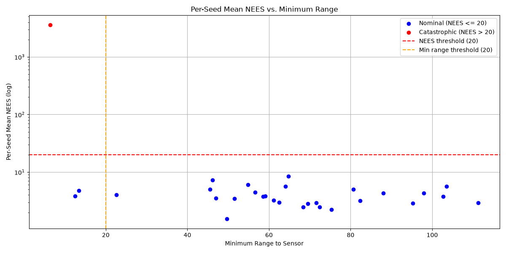

**Maneuvering EKF (straight legs only): per-seed NEES vs. minimum range to sensor**
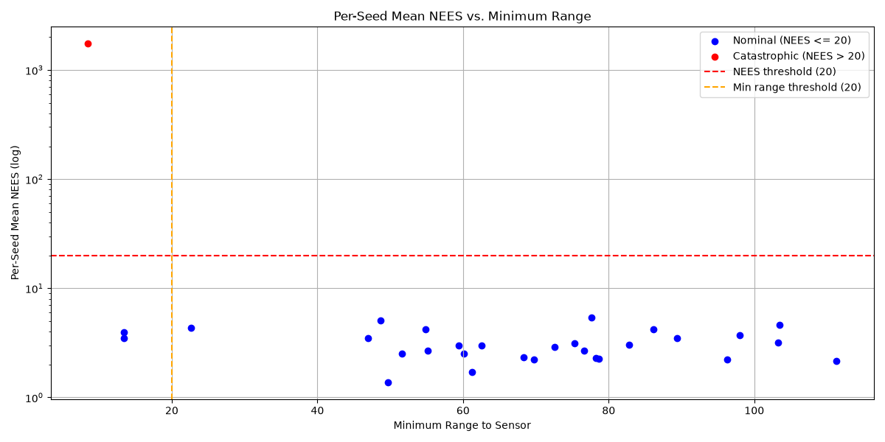

**Maneuvering EKF (turning legs only): per-seed NEES vs. minimum range to sensor**
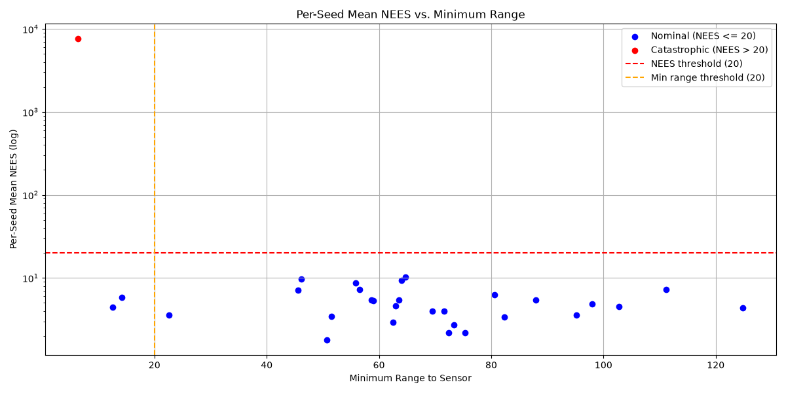

**Maneuvering UKF (overall): per-seed NEES vs. minimum range to sensor**
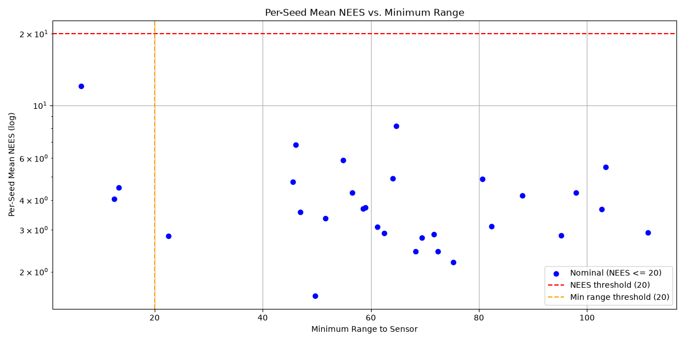

**Maneuvering UKF (straight legs only): per-seed NEES vs. minimum range to sensor**
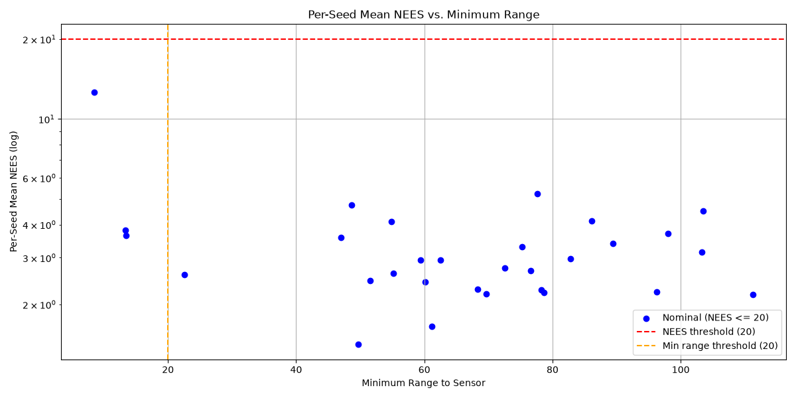

**Maneuvering UKF (turning legs only): per-seed NEES vs. minimum range to sensor**
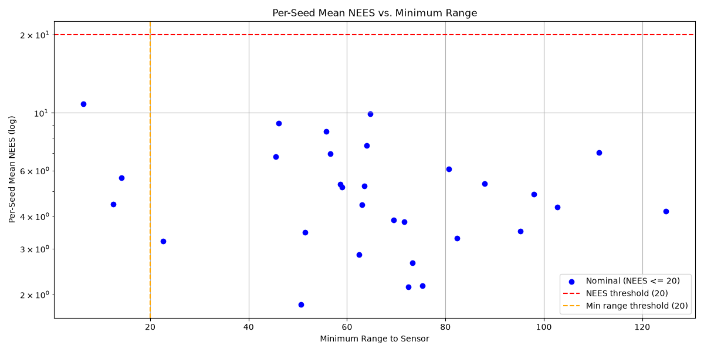

**Maneuvering IMM (overall): per-seed NEES vs. minimum range to sensor**
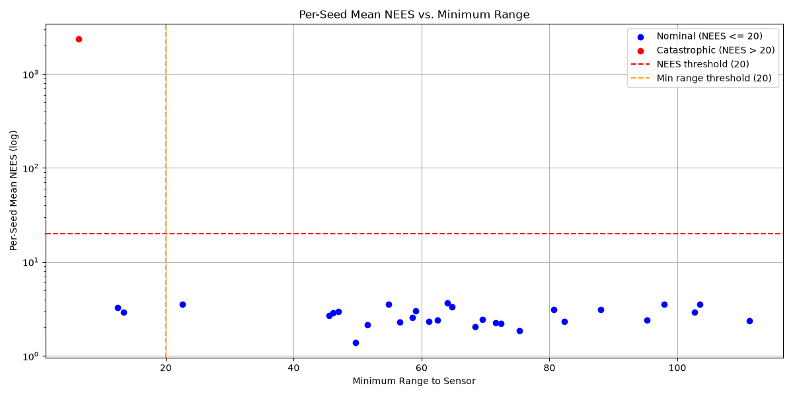

**Maneuvering IMM (straight legs only): per-seed NEES vs. minimum range to sensor**
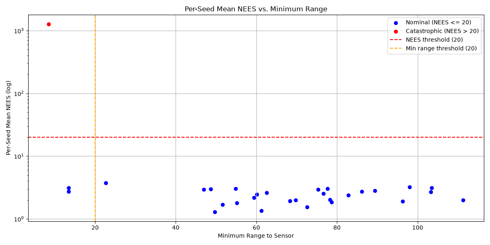

**Maneuvering IMM (turning legs only): per-seed NEES vs. minimum range to sensor**
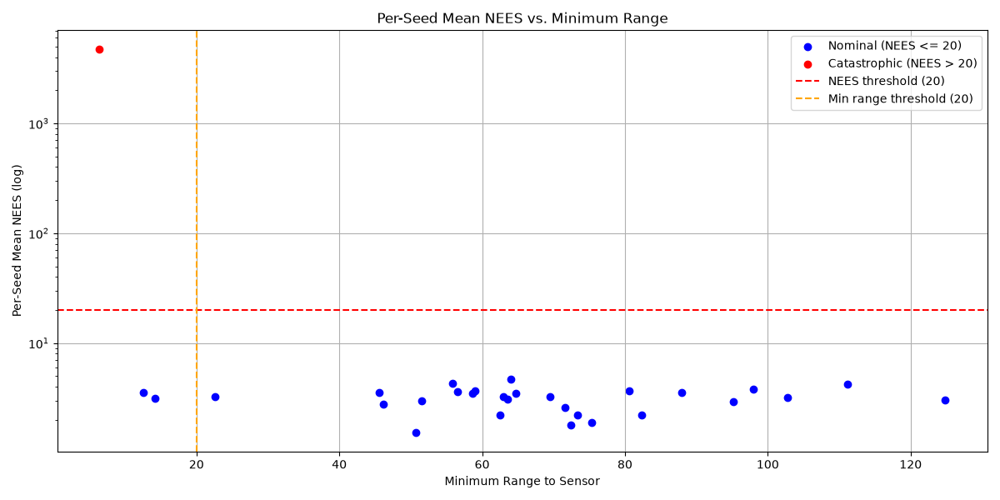

**Contaminated/bearing-only: a genuinely different shape, checked as a negative control.** Catastrophic points are spread across the entire min-range axis here, with no clustering near the sensor. This rules out the spawn-proximity mechanism stated above. This is the contaminated-Gaussian noise working as designed, and bearing-only's slow-triangulation geometry makes it dramatically worse.

**Contaminated EKF: per-seed NEES vs. minimum range to sensor**
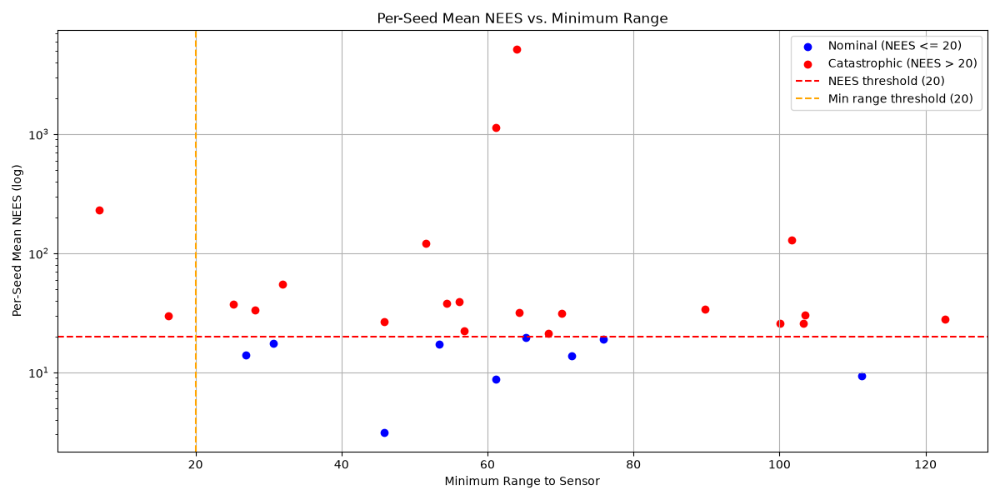

**Bearing-only EKF: per-seed NEES vs. minimum range to sensor**
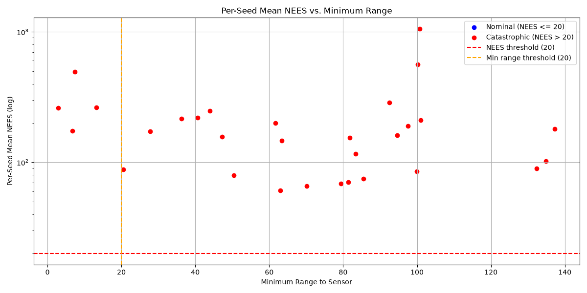

**Bearing-only UKF: per-seed NEES vs. minimum range to sensor**
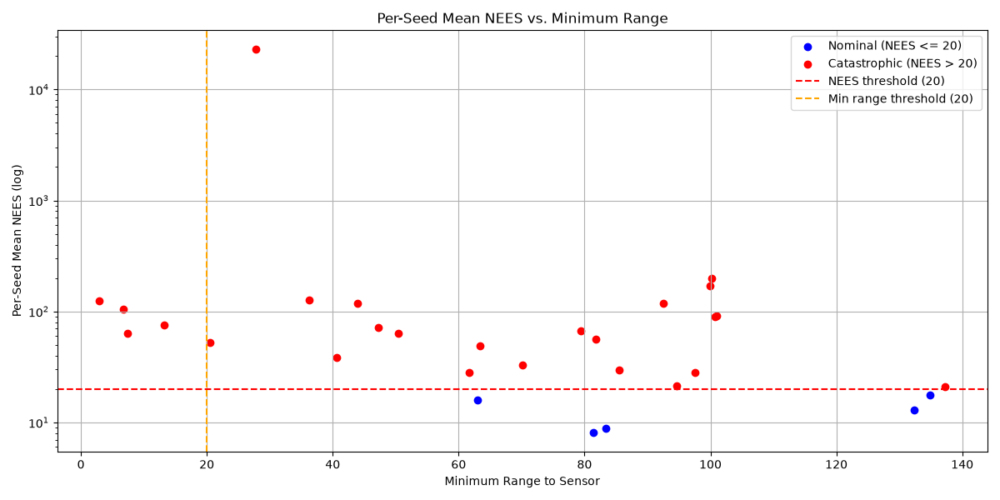

**Dual-sensor fusion: the same spawn-proximity mechanism as benign, but it also exposes a real difference between fusion styles.** Sequential fusion's scatter is almost entirely nominal (blue) — it corrects a single filter's state immediately via the second sensor's update within the same step. Track-level naive and CI fusion's scatter shows the same catastrophic seeds as benign (2020, 2028), since independently-run tracks can drift further on bad geometry before a post-hoc fusion step ever sees them.

**Dual-sensor sequential fusion (EKF): per-seed NEES vs. minimum range to sensor**
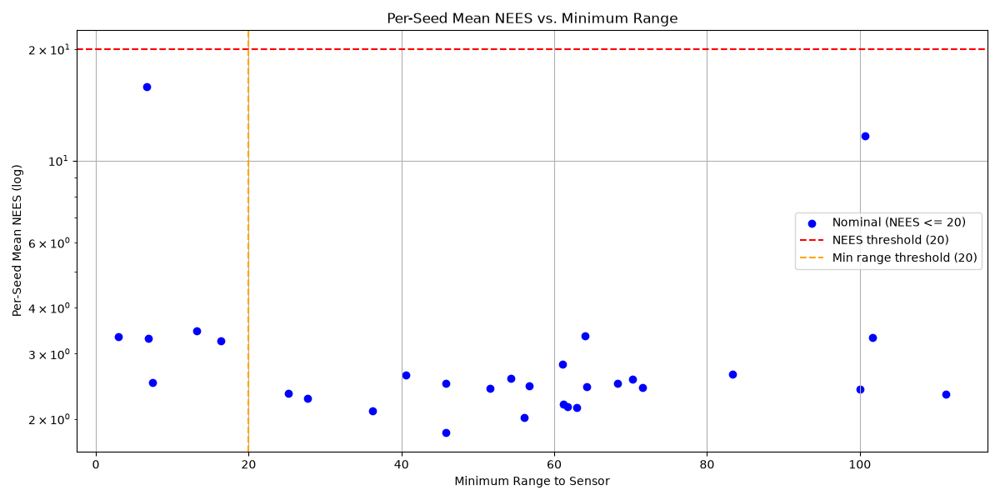

**Dual-sensor sequential fusion (UKF): per-seed NEES vs. minimum range to sensor**
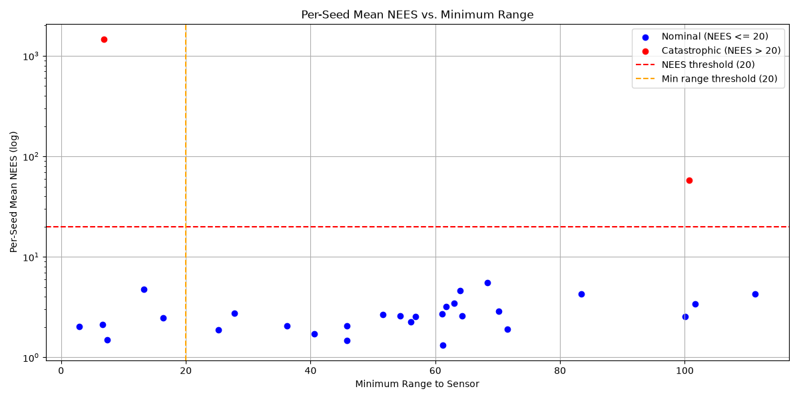

**Dual-sensor naive fusion (EKF): per-seed NEES vs. minimum range to sensor**
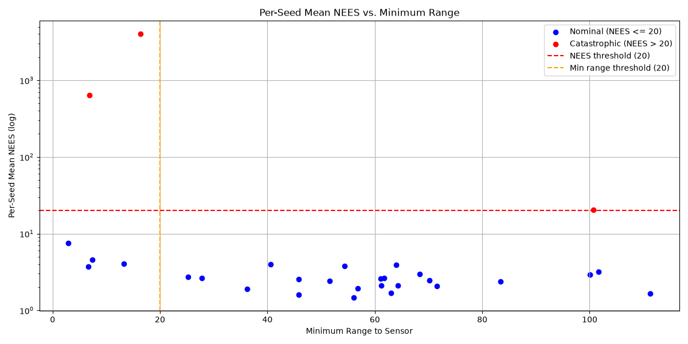

**Dual-sensor naive fusion (UKF): per-seed NEES vs. minimum range to sensor**
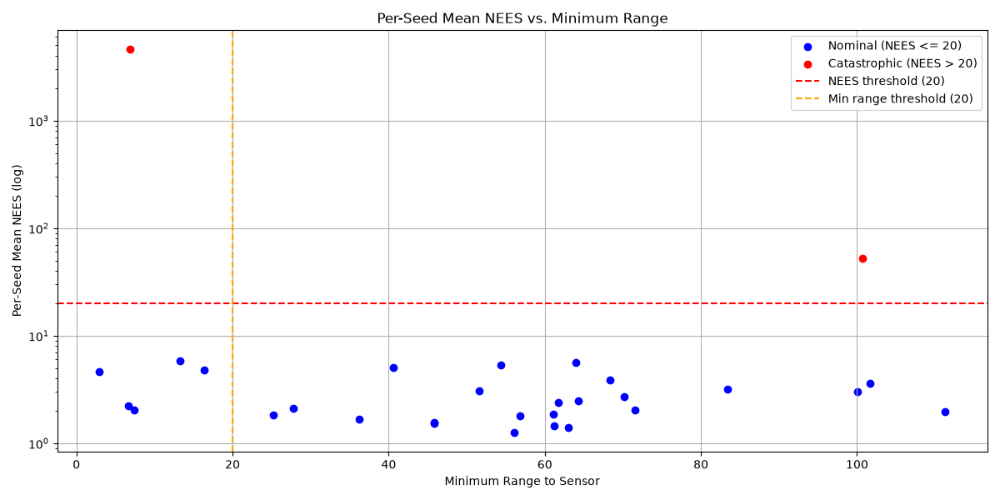

**Dual-sensor CI fusion (EKF): per-seed NEES vs. minimum range to sensor**
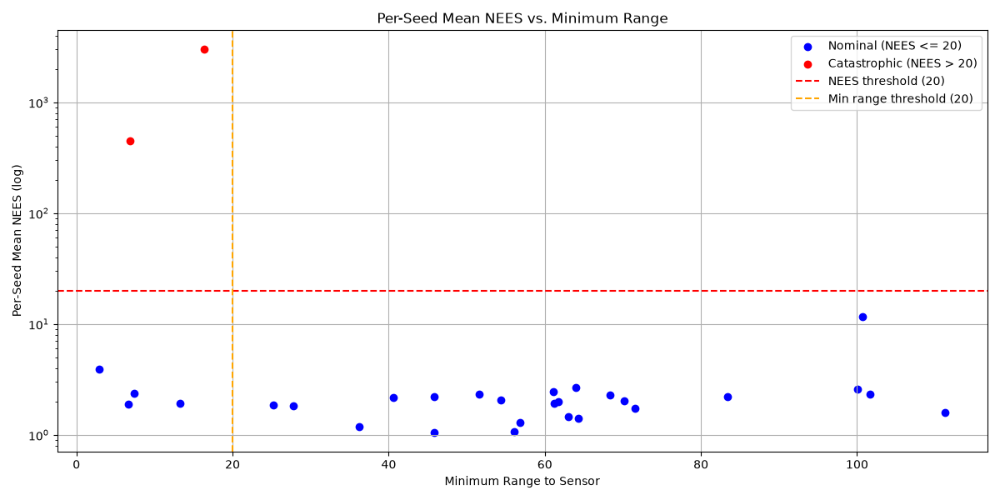

**Dual-sensor CI fusion (UKF): per-seed NEES vs. minimum range to sensor**
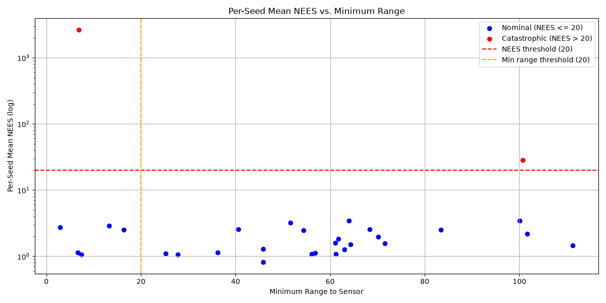

Run via `python scripts/report_scenario_outliers.py`. It writes one `{scenario}_{method}_outliers.json` summary and one `{scenario}_{method}_nees_vs_range.png` plot per row to `data/processed/` and `figures/` respectively.

## Variable Dictionary

### Classical filter math (state-space core)

| Name | Meaning | Shape | Units | Source |
|---|---|---|---|---|
| `x` | State estimate, `[px, py, vx, vy]` | `(4,)` | m, m, m/s, m/s | `src/fusion/filters/{ekf,ukf,imm}.py` |
| `P` | State error covariance | `(4,4)` | m², m²/s² (mixed) | all filter files |
| `F` | State transition matrix, `x_pred = F @ x` | `(dim_x,dim_x)` | — | `models/motion.py`, `learned/diff_kf.py` |
| `Q` | Process-noise covariance added during predict | `(dim_x,dim_x)` | m², m²/s² (scales with `sigma_a²`) | `models/motion.py`, `learned/diff_kf.py` |
| `H` | Measurement Jacobian/selection matrix | `(dim_z,dim_x)` | — | `models/{radar,eoir,adaptive_position}.py` |
| `R` | Measurement noise covariance | `(dim_z,dim_z)` | m² (range), rad² (bearing) | `models/{radar,eoir,adaptive_position}.py` |
| `K` | Kalman gain | `(dim_x,dim_z)` | — | `filters/ekf.py`, `filters/ukf.py`, `learned/diff_kf.py` |
| `S` | Innovation covariance, `H P Hᵗ + R` | `(dim_z,dim_z)` | matches `R` | `filters/{ukf,imm}.py`, `filters/utils.py` |
| `y` | Innovation/residual, `z - h(x)`, angle-wrapped where needed | `(dim_z,)` | matches `z` | `filters/{ukf,imm}.py`, `learned/diff_kf.py` |
| `z` | Raw measurement vector | `(dim_z,)` | m / rad (sensor-dependent) | `models/`, `filters/` |
| `x0`, `P0` | Initial state estimate / initial covariance used to seed a new track | `(4,)`, `(4,4)` | — | `learned/clutter.py`, config `initialization.P0`/`P0_bearing` |
| `dt` | Time step since the last update | scalar | seconds | throughout |
| `dim_x`, `dim_z` | State / measurement vector length | int | — | all model/filter classes |

### UKF sigma-point parameters

| Name | Meaning | Shape | Units | Source |
|---|---|---|---|---|
| `alpha` | Sigma-point spread parameter | scalar (`1e-3`) | — | `filters/ukf.py:sigma_points` |
| `beta` | Prior-knowledge weighting (2.0 is optimal for a Gaussian) | scalar | — | `filters/ukf.py` |
| `kappa` (UKF) | Secondary scaling parameter (**different `kappa` than the contamination-noise one below**) | scalar (`0.0`) | — | `filters/ukf.py` |
| `lambda_` | Derived scaling factor, `alpha²(n+kappa) - n` | scalar | — | `filters/ukf.py:sigma_points` |
| `points` | Sigma points generated around `(x, P)` | `(2n+1, n)` | — | `filters/ukf.py:sigma_points` |
| `Wm`, `Wc` | Sigma-point weights for mean / covariance reconstruction | `(2n+1,)` | — | `filters/ukf.py:sigma_points` |
| `Cxz` | State-measurement cross-covariance from transformed sigma points, `≈ P Hᵗ` | `(dim_x,dim_z)` | — | `filters/ukf.py:_measurement_prediction` |
| `H_eff` | Effective Jacobian backed out of `Cxz` (`H_eff = (P⁻¹Cxz)ᵗ`) so the generalized Joseph form can be applied | `(dim_z,dim_x)` | — | `filters/ukf.py:update` |

### IMM (Interacting Multiple Model)

| Name | Meaning | Shape | Units | Source |
|---|---|---|---|---|
| `transition_matrix` | Markov mode-switch probability matrix (rows = previous mode, cols = destination mode) | `(N,N)` | probability | `filters/imm.py`, `configs/imm.yaml` |
| `mode_probs` | Posterior probability of each mode | `(N,)` | sums to 1 | `filters/imm.py` |
| `mu` | Mixing probabilities blending each mode's prior estimate before its own predict step | `(N,N)` | — | `filters/imm.py:predict` |
| `gaussian_mixture_moments` | Combines several `(x_i, P_i)` pairs with weights into one Gaussian (weighted mean + spread-correction cross term) (the function behind "mixing") | — | — | `filters/utils.py` |
| `gaussian_likelihood` | Per-mode Gaussian likelihood of the new measurement, `N(y; 0, S)` (the function behind the mode-probability update) | `(N,)` | — | `filters/utils.py`, `filters/imm.py:update` |
| `omega` (motion) | Fixed turn rate of a coordinated-turn mode (**different `omega` than the fusion weight below**) | scalar | rad/s | `models/motion.py:CoordinatedTurn2D` |
| `sigma_a` | Std of the white-noise acceleration driving `Q` (the process-noise intensity every `tune_*.py` script searches over) | scalar | m/s² | `models/motion.py`, config `tuned.*.sigma_a` |

### Nonlinear sensor models

| Name | Meaning | Shape | Units | Source |
|---|---|---|---|---|
| `sigma_range` | Std of radar range measurement noise | scalar | meters | `models/radar.py` |
| `sigma_bearing` | Std of bearing measurement noise (radar or EO/IR) | scalar | radians | `models/{radar,eoir}.py` |
| `sensor_pos` | Sensor's fixed global position, subtracted before computing range/bearing | `(2,)` | meters | `models/{radar,eoir}.py` |
| `angle_indices` | Indices within `z` that are angular (need wrapping / circular mean) | list[int] | — | `models/radar.py` (`[1]`), `models/eoir.py` (`[0]`) |
| `q` | Squared planar distance `dx²+dy²`, floored at `1e-6` to avoid a singular Jacobian at the sensor origin | scalar | m² | `models/{radar,eoir}.py` |
| `wrap_angle` / `residual_with_angles` | Wrap an angle (or an angular residual) into `(-π, π]` before it's used in any innovation, sigma-point spread, or fusion residual | — | radians | pinned `target-tracking` package |
| `circular_mean` | Weighted circular mean of angles (`atan2` of weighted sin/cos), used instead of an arithmetic mean anywhere a predicted measurement has an angular component | returns scalar | radians | `filters/utils.py` |

### Contaminated (non-Gaussian) sensor noise

| Name | Meaning | Shape | Units | Source |
|---|---|---|---|---|
| `epsilon` | Probability a given noise sample is drawn from the contaminated (outlier) branch | scalar in `[0,1]` | probability | `sim/noise.py:contaminated_gaussian_noise` |
| `kappa` (contamination) | Variance-inflation factor for the contaminated branch, `cov = kappa² · R` | scalar | — | `sim/noise.py` |

### Fusion (measurement-level and track-level)

| Name | Meaning | Shape | Units | Source |
|---|---|---|---|---|
| `fuse_sequential` | Fuses two sensors by reassigning one filter's `measurement` model between `update()` calls | — | — | `fuse/sequential.py` |
| `fuse_naive` | Track-level fusion via inverse-covariance-weighted combination of two independent estimates (optimal only if they're uncorrelated) | — | — | `fuse/naive.py` |
| `covariance_intersection` (CI) | Track-level fusion that never assumes independence, so it's never overconfident (can be more conservative than naive) | — | — | `fuse/covariance_intersection.py` |
| `omega` (fusion weight) | CI's blending weight in `[0,1]`; chosen via `scipy.optimize.minimize_scalar` to minimize `det(P_fused)` when not given explicitly | scalar | — | `fuse/covariance_intersection.py` |
| `det(P)` | Determinant of a covariance matrix (CI's "uncertainty volume" objective, and the quantity compared across radar-only/EOIR-only/fused in Stage 5) | scalar | m⁴ (2-D position case) | `fuse/covariance_intersection.py` |

### Clutter classifier & multi-target tracking

| Name | Meaning | Shape | Units | Source |
|---|---|---|---|---|
| `compute_features` output | `[min squared-Mahalanobis distance to nearest track, n_gated, local_density, SNR (unused placeholder)]` | `(4,)` | mixed | `learned/clutter.py` |
| Mahalanobis distance | Squared distance `yᵗS⁻¹y` between a detection's innovation and a track's innovation covariance ("how surprising is this detection, in units of this track's own uncertainty" measure) | scalar | dimensionless (chi-square distributed) | pinned `target-tracking` gating code, used in `learned/clutter.py` |
| `gate_confidence` / chi-square gate | Confidence level (and resulting threshold) used to decide which track-detection pairs are kinematically plausible at all | scalar | — | `learned/clutter.py`, config `clutter.gate_confidence` |
| `classifier` | `HistGradientBoostingClassifier` predicting Pr(detection is a real target) from its features | — | — | `learned/clutter.py`, `scripts/train_clutter_classifier.py` |
| `Pr(target)` | Classifier's output probability that a detection originated from a real target rather than clutter | scalar/`(N,)` | probability | `learned/clutter.py`, `learned/clutter_tracker.py` |
| `build_cost_matrix_with_classifier` | Builds the Hungarian assignment cost matrix, `cost_ij = d_ij² − 2·log(Pr(target_j))` inside the gate, `inf` outside it | `(M,N)` tracks×detections | — | `learned/clutter.py` |
| `init_track_from_detection` | The nonlinear-sensor-correct version of track initialization (inverts range/bearing before seeding an `ExtendedKalmanFilter`/`UnscentedKalmanFilter`) | — | — | `learned/clutter.py` |
| `birth_threshold` | Minimum Pr(target) required to "birth" a new tentative track from an unmatched detection | scalar in `[0,1]` | probability | `learned/clutter_tracker.py`, config `heavy_clutter.birth_threshold` (0.3) |
| `MultiTargetTrackerClutter` | Standalone tracker composing `Track`/Hungarian assignment/chi-square gating directly (not a `MultiTargetTracker` subclass), with the classifier folded into birth-gating | — | — | `learned/clutter_tracker.py` |

### Calibration diagnostics

| Name | Meaning | Shape | Units | Source |
|---|---|---|---|---|
| `check_calibration` bins | Quantile-based probability bins the classifier's predictions are grouped into, to check whether "predicted 70%" really means "true 70% of the time" | — | — | `learned/clutter.py:check_calibration` |
| `prob_pred` | Mean predicted probability within a bin (reliability diagram's x-axis) | `(n_bins,)` | probability | `check_calibration` |
| `prob_true` | Empirical positive rate within a bin (the fraction of that bin's detections that were actually real targets; reliability diagram's y-axis) | `(n_bins,)` | probability | `check_calibration` |
| Populated bins (e.g. "12/20") | How many of the probability bins actually received at least one validation sample (a bin with zero samples can't report a meaningful empirical rate, so it's left off the reliability curve entirely rather than plotted as a false "0% true rate") | count | — | `check_calibration` |
| ROC AUC | Probability the classifier ranks a randomly chosen real target above a randomly chosen clutter detection (a ranking-quality metric, independent of the exact probability values) | scalar in `[0,1]` (1 = perfect ranking, 0.5 = random) | — | `scripts/train_clutter_classifier.py` |
| Brier score | Mean squared error between the classifier's predicted probability and the binary target/clutter label (a direct calibration-and-accuracy metric; lower is better, 0 is perfect) | scalar | — | `learned/clutter.py:check_calibration` |

### Learned covariance / Cholesky components

| Name | Meaning | Shape | Units | Source |
|---|---|---|---|---|
| `L` | Lower-triangular Cholesky factor of a predicted covariance, `R_theta = L @ Lᵗ`; diagonal passed through softplus (always positive) and floored, guaranteeing a valid covariance by construction rather than hoping a raw matrix output stays PSD | `(B,dim_pos,dim_pos)` | matches `sqrt` of covariance units | `learned/covariance.py:CovarianceHead` |
| `gaussian_nll` | Per-batch mean negative log-likelihood, `0.5·yᵗS⁻¹y + 0.5·log\|det(S)\|`, solved against `L` via a triangular solve rather than forming `S⁻¹` directly | scalar | — | `learned/covariance.py` |
| `R_theta` / `R_seq` | Learned, per-window measurement covariance replacing the sensor's fixed `R` | `(B,K,dim_pos,dim_pos)` | matches measurement units² | `learned/covariance.py` |
| `sigma_scale` | Multiplier scaling `L`'s diagonal to start near the empirically observed error magnitude | scalar | same units as the error | config `covariance.sigma_scale` |
| `min_diag` | Small floor added to `L`'s diagonal so the covariance can never become singular | scalar | same units | config `covariance.min_diag` |
| `AdaptiveDenoiser` | Wraps a frozen, pretrained `Denoiser` trunk with a trainable `CovarianceHead` | — | — | `learned/covariance.py` |

### Differentiable KF & residual dynamics

| Name | Meaning | Shape | Units | Source |
|---|---|---|---|---|
| `DifferentiableKF` | The standard KF predict/update recursion reimplemented in PyTorch so gradients flow through several chained steps | — | — | `learned/diff_kf.py` |
| `eps` jitter | Small value added to `S`'s diagonal before `torch.linalg.solve`, for numerical stability | scalar (`1e-6`) | — | `learned/diff_kf.py` |
| `dynamics_fn` | Optional hook (`ResidualDynamicsNet.forward`) replacing the fixed `F`/`Q` predict step with a learned correction and covariance | — | — | `learned/diff_kf.py` |
| `delta` | Learned additive correction to the constant-velocity prediction `F @ x` | `(B,dim_x)` | matches state units | `learned/dynamics.py:ResidualDynamicsNet` |
| `h` (hidden state) | The GRU cell's recurrent hidden state — a running summary of a track's recent kinematic history, letting the dynamics correction depend on more than just the current instantaneous state (e.g. "this track has been turning for the last several steps") rather than reacting to each step in isolation | `(B,hidden_dim)` | — | `learned/dynamics.py` |
| `hidden_dim` | Size of that GRU hidden state | int (64) | — | config `dynamics_net.hidden_dim` |
| `ResidualDynamicsKF` | Composes `DifferentiableKF` with `ResidualDynamicsNet` via the `dynamics_fn` hook | — | — | `learned/residual_dynamics_kf.py` |
| `FullPipelineModel` | End-to-end model chaining the (unfrozen, jointly retrained) denoiser trunk → learned `R_theta` → `DifferentiableKF` with `ResidualDynamicsNet` dynamics | — | — | `learned/full_pipeline.py` |

### Datasets / training loop

| Name | Meaning | Shape | Units | Source |
|---|---|---|---|---|
| `window` | Length of the causal window of past raw measurements fed to the `Denoiser` | int (10) | measurement steps | config `dataset.window` |
| `K` (rollout length) | Number of consecutive timesteps used for truncated backpropagation through time (TBPTT) | int (20) | steps | config `rollout.K` |
| `compute_warm_states` | Runs the model once per epoch (no gradient) to build realistic "warm-start" `(x,P[,h])` caches, seeded from the model's own first-window output rather than a fixed global prior | — | — | `learned/datasets.py` |
| `mean`, `std` | Per-channel normalization statistics computed from the training split only, then reapplied at inference | `(dim_z,)` | matches `z` units | `learned/datasets.py:compute_normalization_stats` |
| `val_fraction` | Fraction of *trajectories* (never timesteps) held out for validation | scalar (0.2) | — | config `dataset.val_fraction` |
| `grad_clip_norm` | Max gradient norm before the optimizer step, mandatory for any unrolled/TBPTT training | scalar (1.0) | — | `learned/train.py` |

### Scenario / config

| Name | Meaning | Shape | Units | Source |
|---|---|---|---|---|
| `n_steps` | Simulated time steps per trajectory | int | steps | config `scenario.n_steps` |
| `waypoint_trajectory` | A randomized chain of alternating straight/coordinated-turn legs | returns `(n_steps,4)` | — | `sim/maneuvers.py` |
| `turn_prob` | Probability a given leg is a turn rather than straight | scalar (0.4) | probability | config `scenarios.maneuvering.turn_prob` |
| `omega_range` | `(min,max)` turn-leg angular-rate magnitude sampled per leg | `(2,)` | rad/s | config `maneuver.omega_range` |
| `omega_threshold` | Angular-rate magnitude above which a step is classified "turning" vs. "straight" | scalar (0.02 rad/s) | rad/s | `eval/metrics.py:classify_maneuver_segments` |
| `default_range_guess` | Fallback range assumed when seeding a track from a bearing-only measurement (there's no range to invert) | scalar (100m) | meters | config `scenarios.bearing_only.default_range_guess` |
| `alpha` (tuned baseline inflation) | Multiplier on the denoiser's empirical position-error std, used to build a conservative fixed-`R` baseline, tuned against NEES≈4 (**different `alpha` than the UKF sigma-point parameter above**) | scalar (3.88) | — | `scripts/tune_baseline_alpha.py` |
| `mc_seeds` | Fixed seeds used for the final reported Monte Carlo comparison trials | list[int] | — | config `comparison.mc_seeds` |
| `tuning_seeds` | Fixed seeds used only for hyperparameter tuning, disjoint from `mc_seeds` | list[int] | — | config `tuning_seeds` |
| `spawn_region`, `speed_range` | Bounds for sampling each target's initial position / speed | `(4,)`, `(2,)` | meters, m/s | config `clutter.spawn_region`/`speed_range` |

### Metrics

| Name | Meaning | Shape | Units | Source |
|---|---|---|---|---|
| `RMSE` | Root-mean-square position error, pooled across all MC trials | scalar | meters | `scripts/comparison_common_fn.py` |
| `NEES` | Normalized Estimation Error Squared, `errorᵗ P⁻¹ error` (should average to `dim_x` (4) if the filter is consistent) | scalar | dimensionless | `eval/rollout.py`, `comparison_common_fn.py` |
| `id_switches` | Count of times a track's assigned identity changes relative to ground truth across frames | int | — | pinned `target-tracking` package, via `scripts/run_clutter_comparison.py` |
| `false_track_rate` | Fraction of confirmed tracks that were never matched to any real target over the whole run | scalar in `[0,1]` | — | `eval/metrics.py:false_track_rate` |
